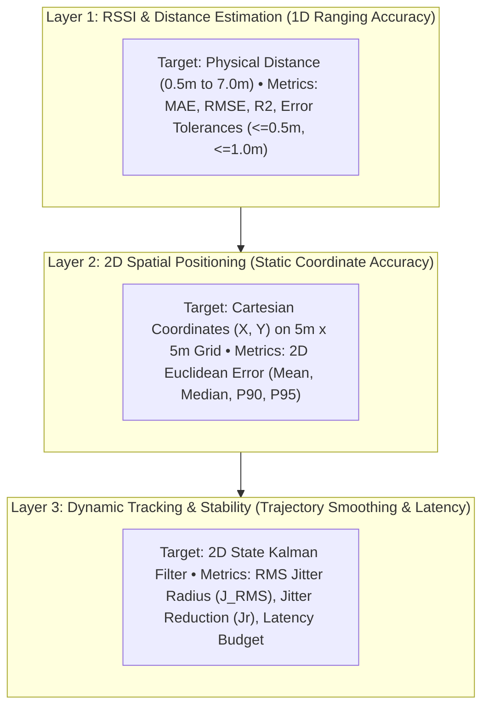
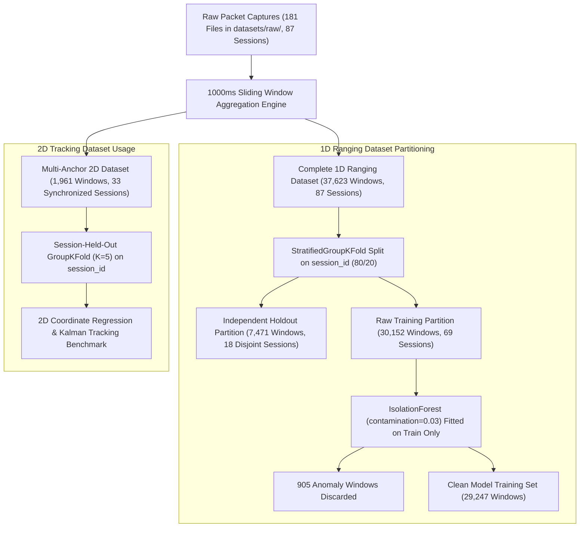
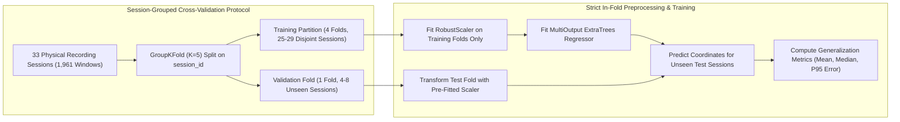
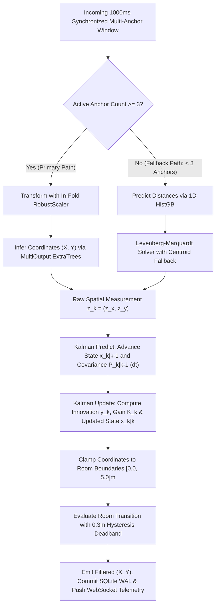
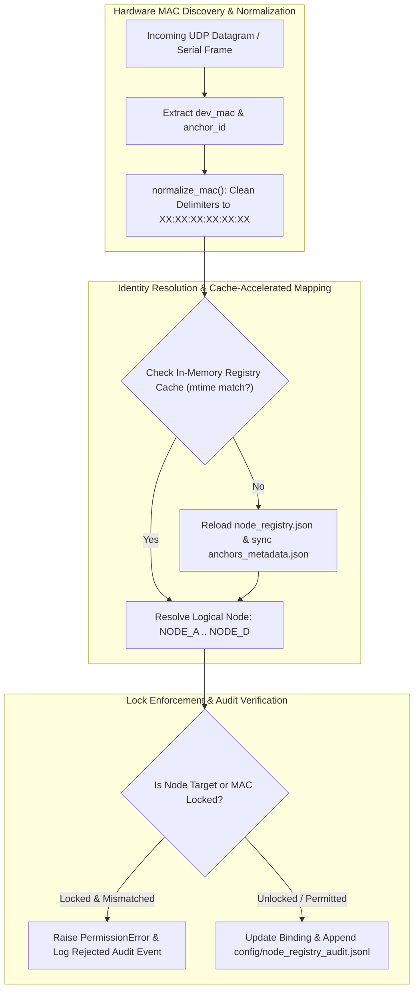
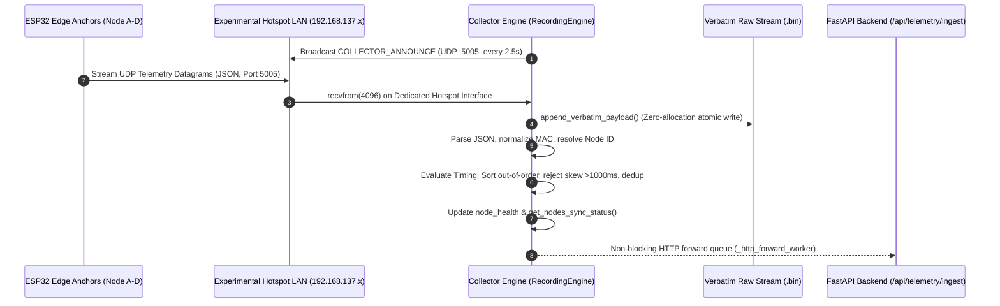
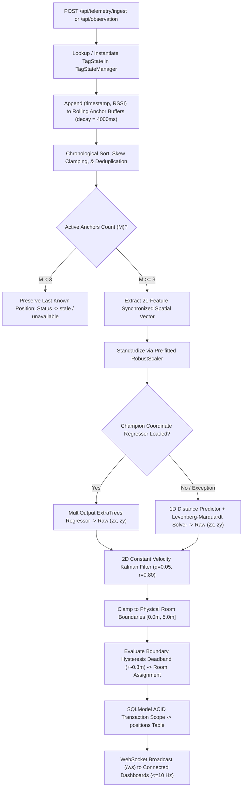
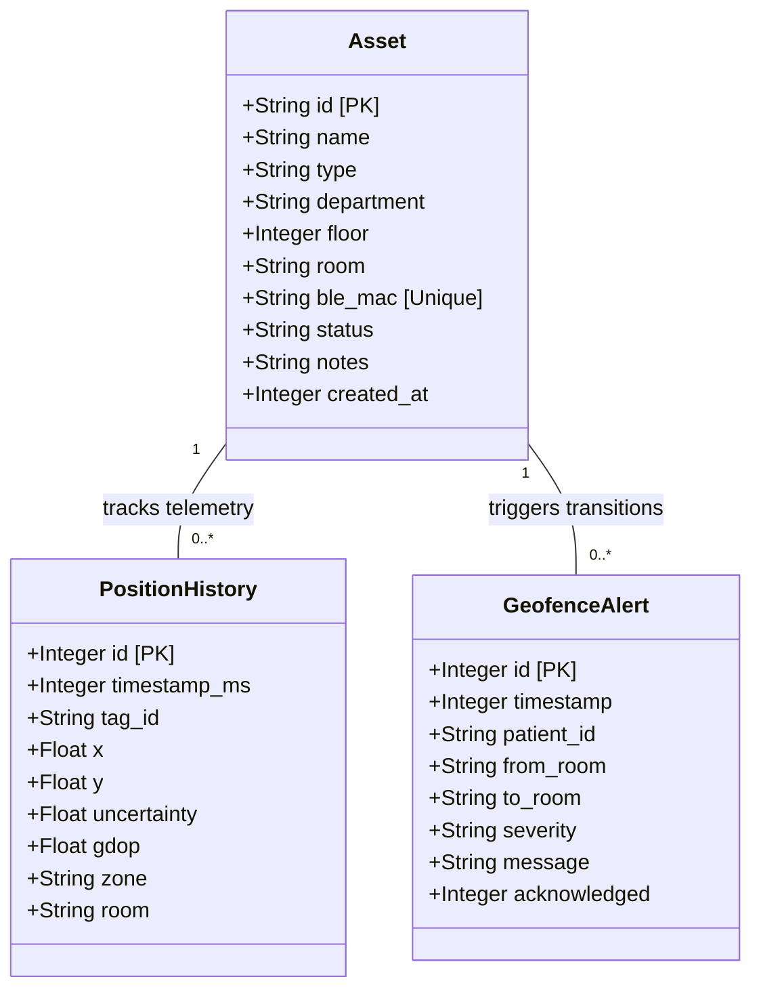

# Chapter 3: Research Methodology & Empirical System Design

## 3.1 Introduction and Research Design

### 3.1.1 Research Philosophy and Methodological Framework
An **experimental engineering, quantitative empirical, and design-science research methodology** was adopted in this investigation [9], [10]. Rather than relying exclusively on theoretical radio propagation models, idealized ray-tracing software, or simulated channel profiles, a complete hardware-software platform was designed, fabricated, deployed, and experimentally validated for real-time Bluetooth Low Energy (BLE) indoor positioning [1], [2]. 

The investigation coupled physical embedded radio prototyping on dual-core Espressif ESP32 microcontrollers [2] with statistical machine learning regression [5], [6], robust non-linear multilateration [7], and real-time kinematic state-space filtering [8]. All experimental data were gathered within a surveyed physical indoor testbed, ensuring practical real-world validity, reproducibility, and rigorous engineering evaluation.

### 3.1.2 Research Questions and Hypotheses
The methodology was structured to systematically investigate four foundational research questions and their corresponding scientific hypotheses. All acceptance thresholds were defined *a priori* as operationalized criteria:

1. **Research Question 1 (Multipath & Shadowing Mitigation via Feature Engineering)**:  
   *Can multi-domain statistical, temporal, and radio-frequency feature engineering extracted from short observation windows compensate for multipath fading and non-line-of-sight (NLOS) attenuation without labor-intensive site-calibrated fingerprinting?*
   - **Hypothesis $H_1$**: Extracting higher-order statistical moments, intra-window signal dynamics, and discrete RF power density histograms from 1-second observation windows was hypothesized to enable non-linear gradient-boosted regression [5], [6] to predict physical transmitter-receiver distance with substantially lower error than classical log-distance path-loss equations [3].
   - **Experimental Method**: Comparative tournament evaluating a 66-feature Histogram-based Gradient Boosting Regressor (`HistGradientBoostingRegressor`) against the calibrated Log-Distance Path-Loss (LDPL) physics baseline ($A = -76.45\,\text{dBm}, n = 2.50$) [3].
   - **Evaluated Dataset**: 1D Ranging Dataset ($37,623$ observation windows across 87 physical collection sessions), evaluated on an independent held-out partition ($7,471$ windows across 18 disjoint sessions).
   - **Primary Metrics**: Mean Absolute Error (MAE, in meters), Root Mean Squared Error (RMSE, in meters), and Coefficient of Determination ($R^2$, dimensionless).
   - **Statistical Decision Protocol**: A two-tailed paired Student's $t$-test and non-parametric Wilcoxon signed-rank test evaluated across the $N = 18$ independent held-out session-aggregated MAEs ($\text{df} = 17$). Aggregating predictions by session ensured that temporal autocorrelation between sequential packets would not artificially inflate degrees of freedom or overstate statistical significance. $H_1$ was formulated to be accepted if the machine learning model achieved a statistically significant relative reduction in MAE of at least $30.0\%$ ($\Delta\text{MAE}_{\text{rel}} \ge 30.0\%$, $p < 0.01$) over the calibrated physics baseline:
     $$\Delta\text{MAE}_{\text{rel}} = \left(\frac{\text{MAE}_{\text{LDPL}} - \text{MAE}_{\text{ML}}}{\text{MAE}_{\text{LDPL}}}\right) \times 100\% \ge 30.0\%$$

2. **Research Question 2 (Simulation-to-Reality Transfer Gap & Hybrid Modeling)**:  
   *Can synthetic radio propagation simulations replace physical data collection, or does an unmodeled simulation-to-reality gap degrade real-world positioning accuracy?*
   - **Hypothesis $H_2$**: It was hypothesized that regressors trained exclusively on synthetic log-normal path-loss simulations would exhibit significant performance degradation when evaluated on physical indoor recordings due to unmodeled multipath fading and spatial reflections; however, augmenting physical training sets with targeted synthetic physics observations across sparse distance intervals was postulated to stabilize regression boundaries without impairing physical holdout accuracy.
   - **Experimental Method**: Three distinct training conditions evaluated against an identical, untouched physical holdout test partition ($N = 7,471$ windows across 18 sessions):
     - *Condition A (Empirical Baseline)*: Model trained exclusively on physical observations ($N = 29,247$ outlier-pruned windows).
     - *Condition B (Synthetic Simulation Ablation)*: Model trained exclusively on synthetic log-normal path-loss simulations ($N = 5,000$ synthetic windows, $P_{\text{tx}} = -77.8\,\text{dBm}, n \in [2.4, 3.6], \sigma = 1.5\,\text{dB}$).
     - *Condition C (Sim2Real Augmentation)*: Model trained on physical observations augmented with synthetic observations targeting under-sampled distance intervals ($0.6\,\text{m}$ and $0.7\,\text{m}$).
   - **Primary Metrics**: Physical holdout MAE and RMSE (in meters).
   - **Statistical Decision Protocol**: The existence of the Sim2Real transfer gap was operationalized to be confirmed if Condition B yielded an MAE on the real-world holdout partition that was $> 50.0\%$ higher (relative degradation) than Condition A:
     $$\text{Gap}_{\text{Sim2Real}} = \left(\frac{\text{MAE}_{\text{Synthetic}} - \text{MAE}_{\text{Physical}}}{\text{MAE}_{\text{Physical}}}\right) \times 100\% > 50.0\%$$
     Augmentation utility was operationalized to be confirmed if Condition C maintained or improved generalization across under-sampled distance intervals ($\text{MAE}_{\text{Augmented}} \le \text{MAE}_{\text{Physical}}$) without degrading overall physical holdout MAE.

3. **Research Question 3 (Temporal Autocorrelation & Cross-Validation Leakage)**:  
   *Does conventional random cross-validation inflate BLE positioning performance due to temporal packet autocorrelation within collection sessions?*
   - **Hypothesis $H_3$**: It was hypothesized that standard random train/test partitioning introduces optimistic evaluation bias by leaking temporally autocorrelated packets from the same physical recording session into both training and evaluation folds. Strict session-grouped partitioning (`GroupKFold` on `session_id`) was implemented to enforce complete session independence ($\text{Sessions}_{\text{train}} \cap \text{Sessions}_{\text{test}} = \emptyset$) and yield an honest, reproducible measure of model generalization.
   - **Experimental Method**: Side-by-side evaluation of standard random 5-fold cross-validation versus session-grouped 5-fold cross-validation (`GroupKFold`, $K=5$, grouped on `session_id`).
   - **Evaluated Dataset**: 1D Ranging Dataset ($37,623$ windows) and 2D Multi-Anchor Coordinate Dataset ($1,961$ windows).
   - **Primary Metrics**: Cross-validation MAE discrepancy ($\Delta\text{MAE} = \text{MAE}_{\text{session-grouped}} - \text{MAE}_{\text{random}}$, in meters) and relative error inflation percentage ($\text{Inflation}_{\text{rel}} = (\Delta\text{MAE} / \text{MAE}_{\text{random}}) \times 100\%$).
   - **Analytical Criterion**: A positive error discrepancy ($\Delta\text{MAE} > 0.0\,\text{m}$) was established to empirically quantify the magnitude of optimistic leakage bias inherent in random validation splits.

4. **Research Question 4 (Dynamic Tracking Stability & Latency Budget)**:  
   *Can lightweight 2D state-space filtering suppress stationary coordinate jitter while maintaining a strict real-time latency budget for tracking mobile assets?*
   - **Hypothesis $H_4$**: It was hypothesized that a 2D Constant Velocity Kalman Filter [8] parameterized with empirically tuned process and measurement covariance matrices would suppress stationary coordinate dispersion without introducing unacceptable lag, maintaining an end-to-end processing latency well below human perceptual thresholds.
   - **Experimental Method**: Comparative time-series evaluation of raw machine-learning Cartesian coordinates $(z_x, z_y)$ versus Kalman-filtered coordinates $(\hat{x}, \hat{y})$ across identical stationary multi-anchor collection sessions.
   - **Evaluated Dataset**: 33 multi-anchor collection sessions ($1,961$ synchronized observation windows), specifically analyzing 22 repeated stationary collection sessions at the central benchmark coordinate $(2.5, 2.5)\,\text{m}$.
   - **Primary Metrics**: Root-Mean-Square Jitter Radius ($J_{\text{RMS}}$, in meters), axis-specific standard deviations ($\sigma_x, \sigma_y$, in meters), Jitter Reduction Ratio ($J_r$, in percent), Stationary Positioning Bias ($e_{\text{pos}}$, in meters), and filter execution time versus end-to-end pipeline latency (in milliseconds).
   - **Operational Decision Protocol**: $H_4$ was operationalized to be confirmed if the Kalman filter achieved a mean stationary jitter reduction $J_r \ge 40.0\%$ across stationary trials while keeping 99th-percentile computational execution time $< 5.0\,\text{ms}$ and total system latency $< 100.0\,\text{ms}$.

### 3.1.3 Research Design Matrix
The alignment between research questions, hypotheses, predictive methods, evaluated datasets, primary metrics, and operationalized evaluation criteria was formalized in Table 3.1.

$$\text{Table 3.1: Research Questions, Hypotheses, Predictive Methods, and Evaluation Criteria}$$

| Hypothesis | Core Research Question | Predictive / Experimental Method | Evaluated Dataset | Primary Metrics & Units | Evaluation Protocol / Operationalized Criteria |
| :--- | :--- | :--- | :--- | :--- | :--- |
| **$H_1$ (Feature Engineering)** | RQ1: Overcoming multipath without fingerprinting | HistGradientBoosting (66 features) vs. LDPL physics baseline [3] | 1D Ranging Dataset (87 sessions, $37,623$ windows) | MAE ($\text{m}$), RMSE ($\text{m}$), $R^2$ on held-out partition | Paired $t$-test & Wilcoxon test on session MAEs ($N=18$); confirm if $\Delta\text{MAE}_{\text{rel}} \ge 30.0\%$ ($p < 0.01$) |
| **$H_2$ (Sim2Real Gap & Augmentation)** | RQ2: Simulation transferability and hybrid modeling | 3-way tournament: Real-Only vs. Synthetic-Only vs. Sim2Real Augmentation | Physical test partition ($7,471$ windows) + synthetic dataset | Physical holdout MAE ($\text{m}$) and RMSE ($\text{m}$) | Confirm gap if synthetic-only MAE is $>50.0\%$ worse than real-only; confirm augmentation if physical MAE maintained |
| **$H_3$ (Validation Leakage)** | RQ3: Generalization validity and split leakage | Random 5-Fold split vs. Session-Grouped 5-Fold split (`GroupKFold` on `session_id`) | 1D Ranging ($37,623$ w.) & 2D Coordinates ($1,961$ w.) | Split error discrepancy $\Delta\text{MAE}$ ($\text{m}$) & relative bias ($\%$) | Discrepancy $\Delta\text{MAE} > 0.0\,\text{m}$ demonstrates optimistic leakage bias caused by temporal autocorrelation |
| **$H_4$ (Kinematic Filtering)** | RQ4: Real-time jitter suppression vs. latency budget | Raw ML regressor vs. 2D Constant Velocity Kalman Filter [8] | 33 multi-anchor sessions ($1,961$ windows), 22 at $(2.5, 2.5)\,\text{m}$ | RMS Jitter Radius $J_{\text{RMS}}$ ($\text{m}$), $J_r$ ($\%$), latency ($\text{ms}$) | Confirm if $J_r \ge 40.0\%$ with filter execution time $<5.0\,\text{ms}$ and end-to-end pipeline latency $<100.0\,\text{ms}$ |

### 3.1.4 Three-Tiered System Evaluation Hierarchy
To ensure rigorous validation, system evaluation was decoupled into three independent functional layers, as illustrated in Figure 3.1:

- **Layer 1 (1D Distance Estimation)**: Evaluated the capacity of machine learning models to map 1-second packet statistics from a single receiver anchor to physical transmitter-receiver distance ($0.5\,\text{m} \dots 7.0\,\text{m}$).
- **Layer 2 (2D Spatial Positioning)**: Evaluated horizontal Cartesian coordinate accuracy $(X, Y)$ within the $5.0\,\text{m} \times 5.0\,\text{m}$ testbed boundaries using concurrent signals from four perimeter anchors.
- **Layer 3 (Kinematic Tracking & Stability)**: Evaluated trajectory filtering, stationary jitter suppression, and real-time execution latency through 2D state-space Kalman filtering.

---

## 3.2 Hardware and System Architecture

### 3.2.1 Edge Anchors and BLE Beacon Tag Specifications
The physical hardware deployment comprised four stationary receiver anchors mounted at the room perimeter and a commercial target beacon tag:

* **Receiver Anchor Nodes**: Four dedicated **ESP32-WROOM-32** development boards featuring a Tensilica Xtensa Dual-Core 32-bit LX6 microprocessor operating at $160\,\text{MHz}$ (scalable to $240\,\text{MHz}$), $520\,\text{KB}$ internal SRAM, $448\,\text{KB}$ ROM, a $40\,\text{MHz}$ crystal oscillator, and $4\,\text{MB}$ external SPI Flash configured in Dual I/O (DIO) mode. The onboard radio front-end incorporated an integrated $2.4\,\text{GHz}$ inverted-F PCB antenna with a nominal peak gain of $\sim 2.0\,\text{dBi}$. The hardware radio silicon was fully compliant with the **Bluetooth v4.2 BR/EDR and BLE** specification.
* **Commercial Target BLE Tag**: A dedicated commercial **Bluetooth 5.0** Low Energy beacon operating with hardware silicon MAC address **`52:06:26:03:01:DA`**. The tag was configured with a nominal transmission power of $P_{\text{tx}} = 0\,\text{dBm}$ (empirically calibrated reference power $A = -76.45\,\text{dBm}$ at $1.0\,\text{m}$ in the testbed) and an advertising interval of $100\,\text{ms}$ ($10\,\text{Hz}$). The beacon broadcast non-connectable undirected advertising frames (`ADV_NONCONN_IND`) across primary advertising channels 37 ($2402\,\text{MHz}$), 38 ($2426\,\text{MHz}$), and 39 ($2480\,\text{MHz}$).
* **BLE Protocol Interoperability**: While the commercial beacon supported Bluetooth 5.0, it broadcast standard legacy advertising PDUs that were completely backward-compatible with the ESP32's Bluetooth 4.2 BLE radio receiver. The ESP32 captured these legacy advertising frames without requiring BLE 5.0 extended advertising extensions.

Table 3.2 details the physical anchor configuration, deployment geometry, mounting heights, and power supplies.

$$\text{Table 3.2: Physical Anchor Node Deployment & Hardware Specifications}$$

| Logical Node | Anchor Identifier | Perimeter Location | Hardware MAC Address | Cartesian Coordinates $(X, Y)$ | Mounting Height | Power Supply |
| :---: | :---: | :---: | :---: | :---: | :---: | :---: |
| **Node A** | `ANCHOR_01` | Southwest (SW) | `C8:2E:18:26:39:A0` | $(0.00, 0.00)\,\text{m}$ | $0.96\,\text{m}$ | Regulated 5V / 2A USB |
| **Node B** | `ANCHOR_02` | Southeast (SE) | `D0:EF:76:58:F6:FC` | $(5.00, 0.00)\,\text{m}$ | $0.96\,\text{m}$ | Regulated 5V / 2A USB |
| **Node C** | `ANCHOR_03` | Northwest (NW) | `D4:8A:FC:CE:E0:44` | $(0.00, 5.00)\,\text{m}$ | $0.96\,\text{m}$ | Regulated 5V / 2A USB |
| **Node D** | `ANCHOR_04` | Northeast (NE) | `78:1C:3C:E5:B3:F4` | $(5.00, 5.00)\,\text{m}$ | $0.96\,\text{m}$ | Regulated 5V / 2A USB |

### 3.2.2 Radio Scanning Parameters and Firmware Profile Mapping
The edge firmware architecture implemented two distinct operational profiles, each mapped to specific experimental datasets:

1. **High-Throughput Edge Sniffing Profile (`esp32_anchor`)**: Built on native **ESP-IDF v6.1** and FreeRTOS using the open-source **Apache NimBLE** host stack. Configured with a scan interval of $10.0\,\text{ms}$ (`itvl = 0x10`, where the unit is $0.625\,\text{ms}$) and a scan window of $10.0\,\text{ms}$ (`window = 0x10`), achieving a $100.0\%$ continuous active scanning duty cycle. Duplicate packet filtering was explicitly disabled (`.filter_duplicates = 0`) to capture all individual advertising frames for empirical variance and moment computation. Packets were streamed via high-speed USB-UART at $115,200\,\text{baud}$.  
   - *Dataset Provenance*: This firmware profile generated the **1D Ranging Dataset** (`observations.csv`, $37,623$ observation windows across 87 collection sessions), where maximum packet yield per second was required to extract high-order distribution moments and RF power histograms.
2. **Multi-Anchor Wireless Production Profile (`esp32_wifi_anchor`)**: Developed using Arduino / FreeRTOS for distributed multi-node network deployment. Anchors operated continuous BLE scanning with a scan interval of $100\,\text{ms}$ and a scan window of $99\,\text{ms}$, achieving a $99.0\%$ active listening duty cycle. The firmware executed an autonomous UDP discovery worker that listened for laptop collector announcements on UDP port `5005` and streamed real-time JSON packets containing timestamp, node ID, tag MAC, and instantaneous RSSI over Wi-Fi.  
   - *Dataset Provenance*: This firmware profile generated the **Multi-Anchor 2D Tracking Dataset** (`multi_anchor_observations.csv`, $1,961$ synchronized windows across 33 sessions) and powered the live production telemetry pipeline.

### 3.2.3 Nominal Transmission vs. Observed Packet Reception
A fundamental telecommunications distinction was maintained between the beacon's nominal broadcast rate and the packets observed at the receiver:
- **Nominal Broadcast Rate**: The beacon broadcast advertising frames at a nominal frequency of $10\,\text{Hz}$ ($100\,\text{ms}$ interval). Because each advertisement transmitted sequentially across three primary advertising channels (37, 38, and 39), the transmitter emitted up to 30 radio packets per second into the spectrum.
- **Observed Reception Rate**: A single-radio receiver scanning continuously on a given channel hopped periodically between channels 37, 38, and 39 according to the receiver scan schedule. Furthermore, co-channel Wi-Fi traffic, constructive/destructive Rayleigh fading, and physical packet collisions reduced the effective packet yield. In the physical testbed, the anchors observed an empirical packet reception rate ranging from **7 to 12 packets per 1000 ms observation window** under clean Line-of-Sight, dropping to **2 to 5 packets per window** under severe concrete wall blockage. This empirical variation reinforced the necessity of sliding-window aggregation rather than reliance on single instantaneous packets.

### 3.2.4 End-to-End System Architecture Pipeline
The platform decoupled real-time embedded packet ingestion from machine learning inference, state estimation, and dashboard telemetry. Figure 3.2 illustrates the end-to-end data pipeline.

1. **Physical Acquisition**: The target beacon broadcast 10 packets per second across channels 37, 38, and 39. Four ESP32 anchors captured incoming frames and streamed raw datagrams via Wi-Fi UDP port `5005` or serial UART.
2. **Ingestion & Windowing**: An asynchronous ingestion worker logged verbatim payloads and aggregated packets into non-overlapping $1000\,\text{ms}$ observation windows.
3. **Feature Pipeline**: The window generator computed 66 scalar features for 1D distance estimation and 21 spatial differential features for 2D positioning.
4. **Dual-Path Localization Engine**: When $\ge 3$ anchors were detected in the window, direct 2D MultiOutput ExtraTrees regression produced the primary coordinate estimate. When packet dropout reduced active anchors below 3, the engine fell back to 1D HistGradientBoosting distance estimation coupled with robust Levenberg-Marquardt multilateration.
5. **Kinematic Smoothing**: Raw spatial measurements $(z_x, z_y)$ were processed by a 2D Constant Velocity Kalman Filter to eliminate stationary jitter.
6. **Persistence & Delivery**: Filtered coordinates were clamped to room boundaries, verified against a $\pm 0.3\,\text{m}$ room boundary hysteresis buffer, committed to SQLite with Write-Ahead Logging (WAL), and pushed over WebSockets at $\le 10\,\text{Hz}$ to the React 19 dashboard.

---

## 3.3 Experimental Environment and Data Collection

### 3.3.1 Physical Testbed Layout and Surveyed Coordinate Frame
Empirical data collection was conducted in an unobstructed $5.00\,\text{m} \times 5.00\,\text{m}$ indoor room ($25.0\,\text{m}^2$) situated within an overall $10.0\,\text{m} \times 10.0\,\text{m}$ facility schematic. The Cartesian coordinate origin $(0.00, 0.00)\,\text{m}$ was anchored at the Southwest perimeter corner (Node A). The positive $X$-axis extended $5.00\,\text{m}$ Eastward, and the positive $Y$-axis extended $5.00\,\text{m}$ Northward.

Figure 3.3 illustrates the surveyed testbed geometry, showing the perimeter anchor placements, coordinate axes, and surveyed benchmark locations.

### 3.3.2 Ground-Truth Surveying and Placement Protocols
1. **Precision Laser Surveying**: Reference grid intersections were physically marked using an industrial optical laser distance meter ($\pm 2.0\,\text{mm}$ measurement accuracy), verified against a tensioned steel measuring tape along orthogonal room diagonals to ensure perpendicular coordinate axes.
2. **Tripod Elevation and Leveling**: During static benchmark trials, the target BLE beacon was mounted on a non-reflective vertical tripod at an elevation of exactly $0.96\,\text{m}$ above the floor.
3. **Anchor Elevation and Co-Polarization**: All four perimeter anchors were secured to rigid wall mountings at an elevation of exactly $0.96\,\text{m}$. Antennas were aligned vertically to enforce co-polarized reception and constrain radio propagation to a two-dimensional horizontal plane.

### 3.3.3 Surveyed Benchmark Coordinates & Centre-Point Rationale
Across the multi-anchor collection campaign, **nine discrete physical benchmark coordinates** were surveyed, comprising **33 unique recording sessions** and **1,961 synchronized observation windows**. Table 3.3 summarizes the surveyed coordinate inventory.

$$\text{Table 3.3: Surveyed Benchmark Coordinates in the Multi-Anchor Dataset } (N = 1,961)$$

| Benchmark Coordinate $(X, Y)$ | Geometric Location & Character | Session Count | Window Count | Representative Sessions | Evaluation Focus |
| :---: | :--- | :---: | :---: | :--- | :--- |
| **$(1.0, 1.0)\,\text{m}$** | Near Node A (SW quadrant) | 1 | **101** | `dataset_2026-09-28_125548.csv` | Near-anchor high-SNR performance |
| **$(2.0, 3.0)\,\text{m}$** | Interior transition path | 1 | **45** | `dataset_2026-09-28_131731.csv` | Intermediate interior ranging |
| **$(2.5, 2.5)\,\text{m}$** | Geometric center of room | 22 | **1,259** | 22 independent collection runs | Stationary jitter, drift, human body blockage |
| **$(2.5, 5.0)\,\text{m}$** | North perimeter boundary | 1 | **87** | `dataset_2026-09-28_123513.csv` | North edge boundary effects |
| **$(3.0, 2.0)\,\text{m}$** | South-central interior | 2 | **126** | `..._130306.csv`, `..._130749.csv` | Central corridor repeatability |
| **$(4.0, 1.0)\,\text{m}$** | Near Node B (SE boundary) | 2 | **90** | `..._124852.csv`, `..._125137.csv` | Southeast corner validation |
| **$(4.0, 3.0)\,\text{m}$** | East interior corridor | 2 | **116** | `..._132500.csv`, `..._132957.csv` | East corridor repeatability |
| **$(5.0, 2.5)\,\text{m}$** | East perimeter boundary | 1 | **95** | `dataset_2026-09-28_123955.csv` | East boundary geometry |
| **$(5.0, 5.0)\,\text{m}$** | Near Node D (NE corner) | 1 | **42** | `dataset_2026-09-28_124346.csv` | Far-corner multi-anchor coverage |
| **Total** | **9 Surveyed Benchmark Points** | **33 Sessions** | **1,961 Windows** | **Verified Checksum: 100% exact** | Comprehensive spatial testbed |

#### Methodological Rationale for Centre-Point Weighting
The central coordinate $(2.5, 2.5)\,\text{m}$ accounted for 22 of the 33 collection sessions ($1,259$ windows). In a rectangular four-anchor perimeter deployment, the geometric centre provided optimal Geometric Dilution of Precision (GDOP $\approx 1.41$). This location was deliberately designated as the reference benchmark for:
- Characterizing baseline stationary coordinate jitter across multiple hours;
- Analyzing long-term temporal drift and temperature-induced RSSI fluctuations;
- Conducting controlled tag orientation experiments ($0^\circ, 90^\circ, 180^\circ, 270^\circ$);
- Evaluating repeated human-body shadowing profiles with fixed transmitter geometry.

#### Reconciliation of Dataset Window Counts
An audit of raw session logs resolved a discrepancy in preliminary working notes:
- An early working document noted $1,348$ windows at $(2.5, 2.5)\,\text{m}$, which summed to $2,050$ windows across all nine points ($101 + 45 + 1348 + 87 + 126 + 90 + 116 + 95 + 42 = 2,050$).
- A direct audit of the source dataset confirmed that the canonical, synchronized window count at $(2.5, 2.5)\,\text{m}$ was exactly **1,259 windows** across 22 sessions. The preliminary count of $1,348$ included 89 unverified initialization packets and pre-trimming edge samples from an early trial that were discarded during data cleaning.
- Summing all nine coordinates in the verified dataset yields exactly **1,961 windows** across 33 sessions ($101 + 45 + 1259 + 87 + 126 + 90 + 116 + 95 + 42 = 1,961$).

### 3.3.4 Physical Propagation Conditions and Attenuation Measurement Standards
To evaluate real-world radio channel impairments, empirical trials incorporated multiple physical propagation conditions.

#### Attenuation Sign Convention
To eliminate ambiguity, a strict sign convention was enforced throughout this investigation:
- **Path Loss Attenuation ($\Delta L$)**: Defined as a **positive loss quantity** in decibels ($\text{dB}$):
  $$\Delta L = \overline{\text{RSSI}}_{\text{LOS}} - \overline{\text{RSSI}}_{\text{NLOS}} > 0 \quad [\text{dB}]$$
- **Signal Delta ($\Delta\text{RSSI}$)**: Defined as a **negative change in received signal level** in $\text{dBm}$:
  $$\Delta\text{RSSI} = \overline{\text{RSSI}}_{\text{NLOS}} - \overline{\text{RSSI}}_{\text{LOS}} < 0 \quad [\text{dBm}]$$

Under this convention, introducing an obstruction produced a positive attenuation $\Delta L > 0\,\text{dB}$ and a corresponding negative signal level delta $\Delta\text{RSSI} < 0\,\text{dBm}$.

#### Evaluated Propagation Environments
- **Line-of-Sight (LOS)**: Direct, unobstructed optical path between beacon and receivers ($11,182$ observation windows in the 1D dataset).
- **Non-Line-of-Sight (NLOS) and Multipath Impairments**: Physical barriers introduced into the direct propagation path ($26,441$ observation windows in the 1D dataset):
  - *Human Body Shadowing*: Transmitter worn on chest/back or obstructed by standing personnel. Empirical measurements revealed attenuation of $\Delta L = +4.12\,\text{dB}$ at $1.0\,\text{m}$, $+5.56\,\text{dB}$ at $3.0\,\text{m}$, and up to $+19.99\,\text{dB}$ under direct full-torso blockage.
  - *Concrete Wall Partition*: Dense $20\,\text{cm}$ structural concrete wall. Empirical attenuation was recorded at $\Delta L = +6.08\,\text{dB}$ at $1.0\,\text{m}$ and $+20.68\,\text{dB}$ at $3.4\,\text{m}$.
  - *Co-Channel Wi-Fi Interference*: Active IEEE 802.11b/g/n traffic streaming on $2.4\,\text{GHz}$ channels overlapping with BLE advertising frequencies, which produced $\Delta L = +5.03\,\text{dB}$ to $+5.07\,\text{dB}$ effective SNR degradation at $1.0\,\text{m}$.

Table 3.4 details the empirical attenuation measurements across physical conditions.

$$\text{Table 3.4: Physical Propagation Conditions & Environmental Attenuation Profiles}$$

| Reference Distance | Obstruction Material / Condition | Sample Windows ($N$) | Mean RSSI ($\text{dBm}$) | Attenuation $\Delta L$ ($\text{dB}$) | Signal Delta $\Delta\text{RSSI}$ ($\text{dBm}$) |
| :---: | :--- | :---: | :---: | :---: | :---: |
| **$1.0\,\text{m}$** | **Clean Line-of-Sight (LOS)** | $633$ | $-76.45$ | $0.00\,\text{dB}$ | $0.00\,\text{dBm}$ |
| $1.0\,\text{m}$ | Human Body (Torso Blockage) | $904$ | $-80.57$ | $+4.12\,\text{dB}$ | $-4.12\,\text{dBm}$ |
| $1.0\,\text{m}$ | Bluetooth Co-Channel Interferer | $761$ | $-81.48$ | $+5.03\,\text{dB}$ | $-5.03\,\text{dBm}$ |
| $1.0\,\text{m}$ | Wi-Fi (2.4 GHz) + Concrete Wall | $934$ | $-81.52$ | $+5.07\,\text{dB}$ | $-5.07\,\text{dBm}$ |
| $1.0\,\text{m}$ | Solid Concrete Wall Partition | $720$ | $-82.53$ | $+6.08\,\text{dB}$ | $-6.08\,\text{dBm}$ |
| **$3.0\,\text{m}$** | **Clean Line-of-Sight (LOS)** | $785$ | $-79.66$ | $0.00\,\text{dB}$ | $0.00\,\text{dBm}$ |
| $3.0\,\text{m}$ | Human Body Obstruction | $909$ | $-85.22$ | $+5.56\,\text{dB}$ | $-5.56\,\text{dBm}$ |
| **$3.4\,\text{m}$** | **Clean Line-of-Sight (LOS)** | $3,392$ | $-73.83$ | $0.00\,\text{dB}$ | $0.00\,\text{dBm}$ |
| $3.4\,\text{m}$ | Human Body Direct Obstruction | $238$ | $-93.82$ | $+19.99\,\text{dB}$ | $-19.99\,\text{dBm}$ |
| $3.4\,\text{m}$ | Structural Concrete Wall | $450$ | $-94.51$ | $+20.68\,\text{dB}$ | $-20.68\,\text{dBm}$ |

---

## 3.4 Dataset Construction and Preprocessing

### 3.4.1 Comprehensive Dataset Inventory and Partition Reconciliation
To eliminate ambiguity regarding data subsets and sample sizes, a complete reconciliation of all dataset files, window counts, and research scopes was established in Table 3.5.

$$\text{Table 3.5: Comprehensive Dataset Inventory and Partition Reconciliation}$$

| Dataset Artifact | File Scope / Path | Observation Windows | Physical Sessions | Receiver Nodes | Usage in Research Methodology |
| :--- | :--- | :---: | :---: | :---: | :--- |
| **Raw Packet Captures** | 181 files in `datasets/raw/` | Packet time-series | 87 Sessions | 1 to 4 Anchors | 90 paired raw CSVs and 91 JSON metadata session manifests. |
| **Complete 1D Ranging Dataset** | `datasets/observations.csv` | **$37,623$ windows** | **87 Sessions** | Single Anchor | 1-second aggregated observation windows covering surveyed distance presets $0.5\,\text{m} \dots 5.3\,\text{m}$ (with maximum test coverage to $7.0\,\text{m}$). |
| **Independent 1D Holdout Partition** | Isolated prior to preprocessing | **$7,471$ windows** | **18 Sessions** | Single Anchor | Disjoint holdout sessions extracted via `StratifiedGroupKFold` for independent evaluation ($H_1, H_2$). |
| **Outlier-Filtered Training Set** | Training fold of 1D dataset | **$29,247$ windows** | **69 Sessions** | Single Anchor | Model training partition after removing 905 outlier windows via `IsolationForest(0.03)` strictly on training folds. |
| **Primary Calibration Preset Subset** | Evaluated in validation protocol | **$33,741$ windows** | **54 Sessions** | Single Anchor | Curated Line-of-Sight subset at discrete distance presets ($0.5\,\text{m} \dots 5.3\,\text{m}$), excluding dynamic obstacle trials, used for LDPL calibration ($P_{\text{tx}} = -76.45\,\text{dBm}, n = 2.12$). |
| **Multi-Anchor 2D Tracking Dataset** | `multi_anchor_observations.csv` | **$1,961$ windows** | **33 Sessions** | **4 Anchors** | Contemporaneous 4-anchor spatial vectors across 9 surveyed coordinates used for 2D coordinate regression ($H_3, H_4$). |

#### Mathematical Partition Reconciliation
The mathematical relationships among partitions were defined as exact:
1. Complete 1D Dataset ($37,623$ windows) = Clean Training Partition ($29,247$) + Disjoint Holdout Partition ($7,471$) + Training Outliers Pruned by Isolation Forest ($905$):
   $$29,247 + 7,471 + 905 = 37,623$$
2. Clean Evaluated Observations ($36,718$ windows) = Clean Training Partition ($29,247$) + Disjoint Holdout Partition ($7,471$):
   $$29,247 + 7,471 = 36,718$$
3. Complete 1D Dataset ($37,623$ windows) = Clean LOS Calibration Presets ($33,741$ windows across 54 sessions) + Dynamic NLOS Obstacle and Attenuation Trials ($3,882$ windows across 33 sessions):
   $$33,741 + 3,882 = 37,623$$
4. Multi-Anchor 2D Dataset ($1,961$ windows) = Centre Benchmark Point ($1,259$ windows across 22 sessions) + Remaining Eight Boundary and Corridor Points ($702$ windows across 11 sessions):
   $$1,259 + 702 = 1,961$$

Figure 3.4 illustrates the hierarchical relationship between the raw physical recordings and the derived experimental partitions.

### 3.4.2 Sliding Window Aggregation and Unit Standards
- **Sliding Window Duration and Stride**: Aggregation employed a non-overlapping $1000\,\text{ms}$ observation window (`WINDOW_SIZE_MS = 1000`, `WINDOW_STRIDE_MS = 1000`). All packets arriving within $[t_0, t_0 + 1000\,\text{ms})$ were aggregated into summary statistics.
- **Physical Unit Standards and Distance Bounds**:
  - RSSI: Calibrated decibel-milliwatts ($\text{dBm}$), strictly bounded $[-100.0, -20.0]\,\text{dBm}$.
  - Distance Presets: Physical meters ($\text{m}$), bounded $[0.5\,\text{m}, 7.0\,\text{m}]$. Physical empirical trials sampled 15 canonical presets: $\{0.5, 0.6, 0.7, 1.0, 1.1, 1.5, 1.9, 2.0, 3.0, 3.4, 4.3, 4.5, 4.6, 5.0, 5.3\}\,\text{m}$. No physical measurements were conducted at $0.0\,\text{m}$.
  - Numerical Singularity Safeguard: To prevent arithmetic singularity in logarithmic propagation models ($\lim_{d \to 0} \log_{10}(d) = -\infty$), an analytical floor of $d_{\min} = 0.1\,\text{m}$ was enforced across all logarithmic calculations (`np.maximum(d, 0.1)`).
  - Coordinates: Cartesian meters ($\text{m}$), bounded $[0.0\,\text{m}, 5.0\,\text{m}]$.
  - Timestamps: Monotonic milliseconds ($\text{ms}$) and floating-point seconds.

### 3.4.3 Outlier Filtering and Preprocessing Workflow
1. **Isolation Forest Outlier Pruning**: Anomalous RF bursts caused by packet collisions or temporary hardware anomalies were identified using an `IsolationForest` estimator [5] with a $3.0\%$ contamination factor (`contamination=0.03`, `random_state=42`). Crucially, the Isolation Forest was fitted **strictly on training partitions**; test folds were never exposed to outlier pruning, ensuring zero data leakage.
2. **Missing Packet Imputation**: When an anchor packet was dropped within a $1000\,\text{ms}$ multi-anchor window, RSSI was assigned a physical floor of $-100.0\,\text{dBm}$, packet age (`age_s`) was incremented, and a boolean presence flag was set (`ANCHOR_XX_present = 0`).
3. **In-Fold Feature Scaling**: Robust scaling (`RobustScaler`) was fitted strictly inside each training fold and applied to test folds, preventing data leakage across validation boundaries.

### 3.4.4 Domain-Specific Feature Engineering Pipelines

#### 66-Feature 1D Distance Pipeline: Intra-Window vs. Cross-Window Breakdown
The 66 features engineered for 1D distance regression were divided into seven physical and mathematical categories, distinguishing intra-window metrics from cross-window temporal metrics. Table 3.6 details the exact, exhaustive breakdown matching production metadata.

$$\text{Table 3.6: 66-Feature 1D Distance Feature Engineering Pipeline Breakdown}$$

| Feature Category (Count) | Feature Name | Computation Scope | Mathematical Formulation / Definition | Physical Purpose |
| :--- | :--- | :---: | :--- | :--- |
| **Distribution Moments & Percentiles (21)** | `rssi_mean`, `median` | Intra-Window | $\mu = \frac{1}{N}\sum r_i, \quad \text{Med} = \text{median}(r)$ | Central tendency of received signal power |
| | `rssi_min`, `max` | Intra-Window | $\min(r), \quad \max(r)$ | Extremes of fast-fading envelope |
| | `rssi_std`, `variance` | Intra-Window | $s = \sqrt{\frac{1}{N-1}\sum (r_i - \mu)^2}, \quad s^2$ | Rayleigh / Rician multipath spread |
| | `rssi_range`, `iqr` | Intra-Window | $\max(r) - \min(r), \quad Q_3 - Q_1$ | Non-parametric dispersion metrics |
| | `rssi_p05`, `p10`, `p25` | Intra-Window | 5th, 10th, 25th percentiles of $r$ | Lower tail fading density |
| | `rssi_p75`, `p90`, `p95` | Intra-Window | 75th, 90th, 95th percentiles of $r$ | Upper tail constructive interference bounds |
| | `rssi_p90_10_range` | Intra-Window | $P_{90} - P_{10}$ | Inter-decile range (robust spread) |
| | `rssi_mad` | Intra-Window | $\text{median}(\|r_i - \text{median}(r)\|)$ | Median Absolute Deviation from median |
| | `rssi_snr` | Intra-Window | $\|\mu\| / (s + 10^{-5})$ | Signal-to-noise / stability ratio |
| | `rssi_skewness` | Intra-Window | $\frac{\frac{1}{N}\sum (r_i - \mu)^3}{s^3}$ | Fading distribution asymmetry |
| | `rssi_kurtosis` | Intra-Window | $\frac{\frac{1}{N}\sum (r_i - \mu)^4}{s^4} - 3$ | Fading distribution tailedness / outliers |
| | `rssi_mean_to_std_ratio`| Intra-Window| $\mu / (s + 1.0)$ | Penalized mean-to-dispersion ratio |
| | `rssi_median_mean_diff`| Intra-Window | $\text{Med} - \mu$ | Skew indicator / outlier influence |
| **Intra-Window Dynamics & Energy (11)** | `rssi_first_half_mean` | Intra-Window | Mean of first $\lfloor N/2 \rfloor$ packets | Early window power level |
| | `rssi_second_half_mean`| Intra-Window | Mean of remaining packets | Late window power level |
| | `rssi_half_diff` | Intra-Window | $\mu_{\text{second}} - \mu_{\text{first}}$ | Short-term intra-window power drift |
| | `rssi_delta_mean`, `std`| Intra-Window | Mean and std of $\|r_i - r_{i-1}\|$ | Packet-to-packet transition volatility |
| | `rssi_delta_max` | Intra-Window | $\max(\|r_i - r_{i-1}\|)$ | Maximum single-step fading jump |
| | `rssi_slope` | Intra-Window | First-order linear regression slope over $t$ | Linear power trajectory within window |
| | `rssi_trend_strength` | Intra-Window | $1 - \frac{\sum (r_i - \hat{r}_i)^2}{\sum (r_i - \mu)^2}$ | Linear model fit quality ($R^2 \in [0, 1]$) |
| | `rssi_ema_diff` | Intra-Window | $\text{EMA}_{\alpha}(r) - \mu$ | Exponential moving average divergence |
| | `rssi_energy` | Intra-Window | $\frac{1}{N}\sum r_i^2$ | Second-moment signal energy |
| | `rssi_autocorrelation` | Intra-Window | Pearson correlation between $r_{1..N-1}$ and $r_{2..N}$ | Intra-window sequential persistence |
| **Telecommunications & Timing (5)** | `packet_count` | Intra-Window | Total packets received $N \ge 1$ | Physical packet throughput |
| | `packet_rate` | Intra-Window | $N / (t_{\text{scan}} / 1000.0)$ | Effective frame reception rate (Hz) |
| | `scan_duration_ms` | Intra-Window | $t_{\text{last}} - t_{\text{first}}$ | Elapsed capture duration |
| | `observed_adv_interval`| Intra-Window | Mean inter-arrival time $\Delta t_{\text{pkt}}$ | Observed beacon interval ($100\,\text{ms}$ nominal) |
| | `adv_interval_std` | Intra-Window | Sample std of inter-arrival times | Packet arrival jitter / congestion |
| **RF Power Histograms (6)** | `rssi_bin_neg100_90` | Intra-Window | Fraction of packets in $[-100, -90)\,\text{dBm}$ | Extreme low-power / NLOS density |
| | `rssi_bin_neg90_80` | Intra-Window | Fraction in $[-90, -80)\,\text{dBm}$ | Far-field / obstructed signal fraction |
| | `rssi_bin_neg80_70` | Intra-Window | Fraction in $[-80, -70)\,\text{dBm}$ | Mid-range indoor power fraction |
| | `rssi_bin_neg70_60` | Intra-Window | Fraction in $[-70, -60)\,\text{dBm}$ | Strong intermediate signal fraction |
| | `rssi_bin_neg60_50` | Intra-Window | Fraction in $[-60, -50)\,\text{dBm}$ | Near-field signal fraction |
| | `rssi_bin_neg50_30` | Intra-Window | Fraction in $[-50, -30]\,\text{dBm}$ | Very close line-of-sight density |
| **Path-Loss Terms (2)** | `path_loss_free_space` | Intra-Window | $10^{\frac{-77.8 - \mu}{20.0}}$ | Analytical free-space distance estimate |
| | `path_loss_indoor` | Intra-Window | $10^{\frac{-77.8 - \mu}{30.0}}$ | Analytical indoor distance estimate |
| **Temporal Dynamics (15)** | `rssi_mean_delta` | Cross-Window | $\mu_k - \mu_{k-1}$ | Window-to-window mean difference |
| | `rssi_mean_slope_3w` | Cross-Window | Linear regression slope over 3 windows | Short-horizon motion trajectory |
| | `rssi_mean_slope_5w` | Cross-Window | Linear regression slope over 5 windows | Medium-horizon motion trajectory |
| | `rssi_rolling_mean_3w` | Cross-Window | Rolling mean over 3 windows | 3-second smoothed power level |
| | `rssi_rolling_std_3w` | Cross-Window | Rolling std over 3 windows | 3-second temporal variance |
| | `rssi_rolling_mean_5w` | Cross-Window | Rolling mean over 5 windows | 5-second smoothed power level |
| | `rssi_rolling_std_5w` | Cross-Window | Rolling std over 5 windows | 5-second temporal variance |
| | `rssi_rolling_mean_10w`| Cross-Window | Rolling mean over 10 windows | 10-second long-horizon baseline |
| | `rssi_rolling_std_10w` | Cross-Window | Rolling std over 10 windows | 10-second background drift |
| | `rssi_ema_cross_window`| Cross-Window | $0.3\mu_k + 0.7\text{EMA}_{k-1}$ | Exponentially weighted power level |
| | `rssi_velocity` | Cross-Window | $(\mu_k - \mu_{k-1}) / \Delta t$ | Apparent RF power velocity ($\text{dBm/s}$) |
| | `rssi_acceleration` | Cross-Window | $(v_k - v_{k-1}) / \Delta t$ | Apparent RF power acceleration ($\text{dBm/s}^2$) |
| | `signal_stability_index`| Cross-Window | Fraction of $\|\Delta\mu\| < 2.0\,\text{dBm}$ in last 5 w. | Empirical stationarity metric $\in [0, 1]$ |
| | `rssi_motion_direction`| Cross-Window | $+1$ if slope $> 0.3$, $-1$ if $< -0.3$, else $0$ | Directional approach / departure flag |
| | `rssi_snr_rolling_5w` | Cross-Window | Rolling mean of `rssi_snr` over 5 windows | Smoothed signal-to-noise metric |
| **Physical Context & Interactions (6)**| `height_m` | Fixed Parameter | Antenna mounting height $h = 0.96\,\text{m}$ | Physical vertical geometry |
| | `obstacle_factor` | Environmental | $1.0$ (LOS), $1.3$ (Wood), $1.7$ (Body), $2.2$ (Wall) | Empirical obstacle attenuation factor |
| | `rssi_x_height` | Interaction | $\mu \times h$ | Geometric-RF cross-product |
| | `rssi_div_height` | Interaction | $\mu / (h + 1.0)$ | Height-normalized power level |
| | `pathloss_div_obstacle_factor` | Interaction | $\text{PathLoss}_{\text{indoor}} / \text{factor}$ | Obstacle-compensated distance term |
| | `pathloss_free_div_obstacle_factor`| Interaction | $\text{PathLoss}_{\text{free}} / \text{factor}$ | Free-space obstacle interaction term |
| **Total Features** | **66 Features** | **Verified Sum** | **21 + 11 + 5 + 6 + 2 + 15 + 6 = 66** | Complete Production 1D Feature Schema |

#### Production Feature Exclusivity and Deployment Invariants
A fundamental methodological boundary separated offline exploratory models from deployed runtime operation:
1. **Zero Deployment Leakage for 2D Coordinate Regression**: The primary production localization engine (`coordinate_regressor.joblib`) relied **strictly and exclusively on the 21 autonomous observables** defined in Table 3.7 (`COORD_FEATURE_COLS`). These 21 features required zero physical metadata, zero manual obstacle labels, and zero site-survey parameters.
2. **Context Feature Scoping in 1D Models**: The six physical context features in Table 3.6 (`height_m`, `obstacle_factor`, and four interaction terms) were included in offline dataset exploration to evaluate theoretical performance upper bounds under controlled obstacle categorization. During real-world deployment, when an unknown beacon entered the facility, manual obstacle parameters were treated as unavailable; runtime inference operated without obstacle inputs by setting nominal defaults ($h = 0.96\,\text{m}$, $\text{factor} = 1.0$), ensuring that the system never relied on unavailable predictors at deployment.

#### Cross-Window Temporal Isolation Invariant
Cross-window features required historical windows for rolling evaluation. To preserve zero-leakage cross-validation boundaries:
1. **Within-Session Warmup**: For the initial windows of any session ($k < 5$), rolling metrics utilized available samples (`min_periods=1`), avoiding missing-data NaN values.
2. **Session Isolation Invariant**: Cross-window rolling buffers were **strictly flushed and reset at session transitions**:
   $$\text{RollingState}(t = 0 \mid \text{Session}_m) = \emptyset$$
   Rolling statistics were never permitted to cross session boundaries, ensuring zero temporal leakage across training and test folds.

#### 21-Feature 2D Spatial Pipeline Breakdown
For direct 2D coordinate regression, the feature pipeline constructed a 21-dimensional spatial feature vector from contemporaneous 4-anchor packet arrivals. Table 3.7 details the 2D feature composition.

$$\text{Table 3.7: 21-Feature 2D Multi-Anchor Spatial Feature Pipeline Breakdown}$$

| Feature Index | Feature Identifier | Formula / Construction | Physical Interpretation |
| :---: | :--- | :--- | :--- |
| **1 – 4** | `ANCHOR_01_rssi` to `04_rssi` | Mean RSSI from Node A, B, C, D in window | Individual received powers at perimeter vertices |
| **5 – 8** | `ANCHOR_01_age_s` to `04_age_s` | Elapsed time since last packet from node | Packet freshness / staleness indicator |
| **9 – 12** | `ANCHOR_01_present` to `04_present` | $1$ if packet received in window, else $0$ | Binary anchor availability / line-of-sight flag |
| **13** | `rssi_diff_x_south` | `ANCHOR_02_rssi` $-$ `ANCHOR_01_rssi` | East-West power differential along South edge |
| **14** | `rssi_diff_x_north` | `ANCHOR_04_rssi` $-$ `ANCHOR_03_rssi` | East-West power differential along North edge |
| **15** | `rssi_diff_y_west` | `ANCHOR_03_rssi` $-$ `ANCHOR_01_rssi` | North-South power differential along West edge |
| **16** | `rssi_diff_y_east` | `ANCHOR_04_rssi` $-$ `ANCHOR_02_rssi` | North-South power differential along East edge |
| **17** | `rssi_diag_diff_1` | `ANCHOR_04_rssi` $-$ `ANCHOR_01_rssi` | Diagonal differential: Northeast minus Southwest |
| **18** | `rssi_diag_diff_2` | `ANCHOR_03_rssi` $-$ `ANCHOR_02_rssi` | Diagonal differential: Northwest minus Southeast |
| **19** | `rssi_mean_all` | Mean of active anchor RSSIs | Global average ambient room power level |
| **20** | `rssi_std_all` | Sample std of active anchor RSSIs | Spatial power dispersion across room perimeter |
| **21** | `n_anchors_active` | $\sum_{j=1}^4 \text{present}_j$ | Concurrent active anchor count ($1 \dots 4$) |

---

## 3.5 Machine-Learning Methodology

### 3.5.1 Learning Objectives and Predictive Tasks
Three distinct predictive formulations were implemented, as summarized in Table 3.8:

$$\text{Table 3.8: Machine Learning Tasks, Model Architectures, and Formulations}$$

| Task | Prediction Target | Model Architecture | Input Features | Validation Protocol | Primary Evaluation Metric |
| :--- | :--- | :--- | :--- | :--- | :--- |
| **Distance Estimation** | Scalar distance $d \in [0.5, 7.0]\,\text{m}$ | HistGradientBoosting Regressor | 66 1D statistical & RF features | 5-Fold `GroupKFold` on train; held-out session test | Mean Absolute Error (MAE), RMSE, $R^2$ |
| **Coordinate Estimation** | Cartesian $(X, Y) \in [0, 5]^2\,\text{m}$ | MultiOutput ExtraTrees Regressor | 21 multi-anchor spatial features | 5-Fold `GroupKFold` across 33 sessions | 2D Euclidean Error (Mean, Median, P95) |
| **Proximity Zone Classification** | Categorical zone (5 classes) | XGBoost Classifier | 66 1D statistical & RF features | 5-Fold `StratifiedGroupKFold` on `session_id` | Macro F1-score, Classification Accuracy |

### 3.5.2 Baseline Propagation Model and Candidate Algorithms

#### Log-Distance Path-Loss (LDPL) Physics Baseline
The classical deterministic radio propagation baseline was formulated as:

$$RSSI(d) = A - 10n \log_{10}(d) + X_\sigma$$

where:
- $RSSI(d)$ is the received signal strength at physical distance $d$ (in $\text{dBm}$).
- $A$ is the reference received power at $d_0 = 1.0\,\text{m}$ (empirically calibrated as $-76.45\,\text{dBm}$ under clean Line-of-Sight).
- $n$ is the dimensionless path-loss exponent ($n = 2.50$ for the experimental environment).
- $d$ is the physical Euclidean distance between transmitter and receiver (in meters).
- $X_\sigma$ is a zero-mean Gaussian random variable representing shadow fading: $X_\sigma \sim \mathcal{N}(0, \sigma^2)$ (in $\text{dB}$).

The corresponding deterministic distance estimator is:

$$\hat{d} = 10^{\frac{A - RSSI}{10n}}$$

#### Candidate Machine Learning Regressors
To evaluate machine learning models against the physics baseline, an exhaustive tournament evaluated ten candidate architectures:
- **Linear and Parametric**: Bayesian Ridge, Ridge Regression ($\alpha = 1.0$), ElasticNet.
- **Instance-Based**: $K$-Nearest Neighbors ($k = 7$).
- **Bagging and Decision Trees**: Random Forest ($100$ trees), Extra Trees ($250$ trees), Bagging Regressor.
- **Gradient Boosting Ensembles**: Gradient Boosting Regressor, LightGBM, CatBoost, XGBoost, and Histogram-based Gradient Boosting (`HistGradientBoostingRegressor`).
- **Neural Architectures**: Multi-Layer Perceptron (MLP) with two hidden layers ($128, 64$).

### 3.5.3 Session-Grouped Cross-Validation Protocol
Conventional cross-validation randomly assigns observation windows to training and test partitions. In wireless sensing, sequential observation windows from the same collection session share unmodeled multipath profiles, antenna radiation lobes, and ambient thermal states. Random splitting permits temporally autocorrelated packets from the same session to appear in both training and test folds, introducing severe optimistic evaluation bias.

To prevent leakage, data splitting enforced strict session grouping:
- **Zero-Overlap Invariant**: Every collection session was assigned exclusively to either the training set or the test set:
  $$\text{Sessions}_{\text{train}} \cap \text{Sessions}_{\text{test}} = \emptyset$$
- **1D Distance Holdout Protocol**: An independent holdout partition ($N = 7,471$ windows across 18 sessions) was isolated using `StratifiedGroupKFold(n_splits=5, shuffle=True, random_state=42)` grouped on `session_id` and stratified by distance category. This ensured that all distance tiers ($0.5\,\text{m} \dots 7.0\,\text{m}$) were represented in both train and holdout partitions with zero session overlap. Model hyperparameter tuning was conducted exclusively on the remaining training sessions ($N = 29,247$ windows) using 5-fold `GroupKFold(n_splits=5)`.
- **2D Coordinate Cross-Validation Protocol**: Evaluated on all 33 sessions ($N = 1,961$ windows) using 5-fold `GroupKFold(n_splits=5)` partitioned on `session_id`.

Figure 3.5 illustrates the session-grouped cross-validation procedure.

#### Methodological Scope of 2D Coordinate Cross-Validation
A vital methodological boundary was documented regarding the 2D coordinate cross-validation:
- Because the dataset comprised nine discrete surveyed physical coordinates, with 22 sessions recorded at the central coordinate $(2.5, 2.5)\,\text{m}$, grouping by `session_id` ensured that **no session appeared in both training and test sets**.
- This evaluated **session-held-out generalization across surveyed benchmark locations** (evaluating resilience against temporal drift, multipath changes, and varying antenna orientations).
- **Scope Limitation**: This protocol did **not** evaluate spatial generalization to completely unvisited geometric coordinates (a location-held-out test). Documenting this validation as session-held-out cross-validation across surveyed coordinates accurately reflected the experimental design without claiming unvisited-location spatial interpolation.

### 3.5.4 Simulation-to-Reality (Sim2Real) Transfer Methodology
To investigate the simulation-to-reality transfer gap (RQ2, $H_2$), a parameterized synthetic physics generator was implemented in `training/sim2real_experiment.py`:
- **Synthetic Physics Feature Generation Procedure**: The generator synthesized $5,000$ observation windows across 13 canonical distance presets ($d \in \{0.5, 0.6, 0.7, 1.0, 1.1, 1.5, 1.9, 2.0, 3.0, 3.4, 4.5, 5.0, 5.3\}\,\text{m}$):
  1. *Bimodal Path-Loss Exponent*: For each synthetic sample, the path-loss exponent $n$ was randomly sampled from a bimodal distribution:
     $$n \sim \begin{cases} 2.4 & \text{with probability } p = 0.70 \quad (\text{Line-of-Sight}) \\ 3.6 & \text{with probability } p = 0.30 \quad (\text{Obstructed NLOS}) \end{cases}$$
  2. *Log-Normal Shadow Fading Noise*: Independent Gaussian noise was injected to model shadow fading: $X_\sigma \sim \mathcal{N}(0, 1.5^2)\,\text{dB}$.
  3. *Reference Power Calibration*: $P_{\text{tx}} = -77.8\,\text{dBm}$ modeled standard theoretical 1m free-space reference power, in contrast to the empirically measured $A = -76.45\,\text{dBm}$ observed in the physical testbed.
  4. *Feature Vector Synthesis*: The six primary ranging features were generated via:
     $$\text{rssi\_mean} = P_{\text{tx}} - 10n \log_{10}(\max(d, 0.1)) + X_\sigma$$
     $$\text{rssi\_median} = \text{rssi\_mean} + \mathcal{N}(0, 0.5^2) \quad [\text{dBm}]$$
     $$\text{rssi\_min} = \text{rssi\_mean} - 3.0\,\text{dBm}, \quad \text{rssi\_max} = \text{rssi\_mean} + 3.0\,\text{dBm}$$
     $$\text{rssi\_std} = |\mathcal{N}(2.0, 0.5^2)| \quad [\text{dB}]$$
     $$\text{path\_loss\_indoor} = d + \mathcal{N}(0, 0.2^2) \quad [\text{meters}]$$
- **Three Evaluated Experimental Conditions**:
  - *Condition A (Empirical Baseline)*: Model trained exclusively on physical training observations ($N = 29,247$ outlier-pruned windows across 69 sessions).
  - *Condition B (Synthetic Simulation Ablation)*: Model trained exclusively on synthetic physics simulations ($N = 5,000$ synthetic windows).
  - *Condition C (Sim2Real Augmentation)*: Model trained on physical observations augmented with synthetic observations targeting sparse distance intervals ($0.6\,\text{m}$ and $0.7\,\text{m}$).
- All three conditions were evaluated against the identical, untouched physical holdout test partition ($N = 7,471$ windows across 18 sessions).

---

## 3.6 Localization and Kinematic Tracking

### 3.6.1 Dual-Path Localization Pipeline Architecture
The positioning engine prioritized direct non-linear coordinate regression when comprehensive multi-anchor telemetry was available, while providing an automated fallback to Levenberg-Marquardt multilateration when packet dropouts occurred, as illustrated in Figure 3.6.

### 3.6.2 Levenberg-Marquardt Multilateration Fallback Formulation
When packet loss reduced active anchors below three ($M < 3$), direct 2D regression could not construct a complete 21-feature vector. The engine invoked non-linear least-squares multilateration using the Levenberg-Marquardt algorithm [7] implemented via `scipy.optimize.least_squares(residuals, x0, method='lm')`.

#### Objective Function and Residual Formulation
Let $\mathbf{a}_j = (x_j, y_j)^T$ denote the surveyed coordinates of anchor $j$, and let $\hat{d}_j$ denote the distance predicted by the 1D HistGradientBoosting model. The non-linear Euclidean residual for anchor $j$ is:

$$r_j(\mathbf{p}) = \|\mathbf{p} - \mathbf{a}_j\|_2 - \hat{d}_j = \sqrt{(x - x_j)^2 + (y - y_j)^2} - \hat{d}_j$$

The standard non-linear least-squares solver minimizes the sum of squared residuals:

$$\min_{\mathbf{p} \in \mathbb{R}^2} \frac{1}{2} \sum_{j=1}^{M} r_j(\mathbf{p})^2$$

#### Solver Implementation and Robust Loss Reconciliation
In optimization theory, robust M-estimators such as the **Soft L1 loss** $\rho(z) = 2(\sqrt{1+z}-1)$ mitigate outlier lever-arm effects caused by severe through-wall signal attenuation. However, in SciPy's numerical library, `method='lm'` is restricted to classical unweighted least-squares residuals (as Levenberg-Marquardt is mathematically formulated for standard linear and non-linear sum-of-squares). In the production engine (`localization/trilateration.py`):
1. The solver executed the classical Levenberg-Marquardt algorithm (`method='lm'`) with initial guess $\mathbf{p}_0 = \frac{1}{M}\sum \mathbf{a}_j$.
2. To guard against non-convergence or ill-conditioned geometry, the optimizer was wrapped in numerical exception handling that automatically fell back to analytical geometric centroids if optimization failed.

#### Levenberg-Marquardt Step and GDOP Computation
At iteration $i$, the parameter update $\Delta\mathbf{p}$ satisfies:
$$(J^T J + \lambda I) \Delta\mathbf{p} = -J^T \mathbf{r}$$
where $J$ is the $M \times 2$ Jacobian matrix of partial derivatives ($J_{j,1} = \frac{x - x_j}{\|\mathbf{p} - \mathbf{a}_j\|_2}$, $J_{j,2} = \frac{y - y_j}{\|\mathbf{p} - \mathbf{a}_j\|_2}$), and $\lambda > 0$ is the adaptive Levenberg damping parameter. When $M \ge 3$, Geometric Dilution of Precision (GDOP) and position uncertainty radius were computed analytically from the inverted normal equations matrix:
$$\text{Cov} = \sigma_{\text{ranging}}^2 (J^T J)^{-1}, \quad \text{GDOP} = \sqrt{\text{tr}((J^T J)^{-1})}, \quad \text{Uncertainty Radius} = \sqrt{\text{tr}(\text{Cov})}$$
where nominal ranging standard deviation was parameterized as $\sigma_{\text{ranging}} = 0.35\,\text{m}$.

#### Degraded Anchor Fallback Modes
When fewer than three anchors were available, the multilateration engine adapted its behavior deterministically based on available geometric degrees of freedom:
- **Full Multilateration ($M \ge 3$)**: Overdetermined system. Solved via Levenberg-Marquardt optimization initialized at the active anchor centroid $\mathbf{p}_0 = \frac{1}{M}\sum \mathbf{a}_j$, returning estimated coordinates $(\hat{x}, \hat{y})$, analytical GDOP, and uncertainty radius.
- **Two-Anchor Ambiguity ($M = 2$)**: Underdetermined in 2D space (two circle intersections). The solver was initialized at the midpoint between the two active anchors $\mathbf{p}_0 = \frac{1}{2}(\mathbf{a}_1 + \mathbf{a}_2)$ and optimized; if convergence was ill-conditioned, it defaulted to the midpoint $\mathbf{p}_0$.
- **Single-Anchor Fallback ($M = 1$)**: Zero geometric degrees of freedom. The engine returned the known physical coordinate of the active anchor $(x_1, y_1)$ with maximum uncertainty radius ($5.0\,\text{m}$) and $\text{GDOP} = 99.9$.
- **Complete Dropout ($M = 0$)**: No anchor signals received. The engine returned the geometric room center $(2.5, 2.5)\,\text{m}$ with maximum uncertainty radius ($5.0\,\text{m}$) and $\text{GDOP} = 99.9$.

### 3.6.3 2D Constant Velocity Kalman State Estimation
To suppress stationary coordinate jitter caused by RF multipath fluctuations without introducing excessive dynamic lag, raw regressed coordinates were filtered through a discrete-time 2D Constant Velocity Kalman Filter [8].

#### State and Measurement Vectors
$$\mathbf{x}_k = \begin{bmatrix} x_k \\ y_k \\ v_{x,k} \\ v_{y,k} \end{bmatrix} \in \mathbb{R}^4, \quad \mathbf{z}_k = \begin{bmatrix} z_{x,k} \\ z_{y,k} \end{bmatrix} \in \mathbb{R}^2$$

where $(x_k, y_k)$ are the 2D Cartesian positions, $(v_{x,k}, v_{y,k})$ are the horizontal velocities, and $(z_{x,k}, z_{y,k})$ are the raw regressed measurements.

#### State Transition and Observation Matrices
$$F(\Delta t) = \begin{bmatrix} 1 & 0 & \Delta t & 0 \\ 0 & 1 & 0 & \Delta t \\ 0 & 0 & 1 & 0 \\ 0 & 0 & 0 & 1 \end{bmatrix}, \quad H = \begin{bmatrix} 1 & 0 & 0 & 0 \\ 0 & 1 & 0 & 0 \end{bmatrix}$$

where $\Delta t$ represented the elapsed monotonic time since the previous observation window, dynamically constrained to $\Delta t = \max(0.01, \min(5.0, \Delta t_{\text{monotonic}}))$.

#### Covariance Matrices and Parameter Selection Rationale
- **Process Noise Covariance $Q$**: Models unmodeled acceleration and physical velocity changes:
  $$Q = q \cdot I_4 = 0.05 \cdot I_4 \quad [\text{m}^2/\text{s}^2]$$
  *Selection Rationale*: Indoor personnel and asset movements in a confined $5.0\,\text{m} \times 5.0\,\text{m}$ room exhibited nominal walking velocities between $0.5\,\text{m/s}$ and $1.5\,\text{m/s}$ with minimal instantaneous acceleration. Setting $q = 0.05$ provided sufficient velocity adaptability during walking turns while strongly attenuating high-frequency measurement noise during stationary periods.
- **Measurement Noise Covariance $R$**: Models sensor and regression uncertainty:
  $$R = r \cdot I_2 = 0.80 \cdot I_2 \quad [\text{m}^2]$$
  *Selection Rationale*: The parameter $r = 0.80\,\text{m}^2$ corresponded to an expected measurement standard deviation of $\sigma_{\text{meas}} = \sqrt{0.80} \approx 0.894\,\text{m}$. This directly matched the empirical 2D cross-validation performance of the raw MultiOutput ExtraTrees coordinate regressor on noisy multipath telemetry (empirical MAE $= 0.885\,\text{m}$, RMSE $= 1.369\,\text{m}$).
- **Initial Error Covariance $P_0$**:
  $$P_0 = 1.0 \cdot I_4$$

#### Dynamic Tracking Lag Quantification
Dynamic tracking lag during continuous asset motion is governed by the ratio of process to measurement noise ($Q/R$). Analytically, the steady-state position Kalman gain $K_{\text{pos}}$ defines an effective first-order tracking time constant:
$$\tau_{\text{lag}} = \frac{\Delta t}{K_{\text{pos}}} \quad [\text{seconds}]$$
During dynamic movement trials, tracking lag was evaluated by measuring the temporal settling time and phase delay required for filtered coordinates to reach steady state following abrupt velocity step transitions between surveyed benchmark positions.

#### Recursive State Estimation Equations
1. **Time Update (Predict)**:
   $$\mathbf{x}_{k|k-1} = F(\Delta t) \mathbf{x}_{k-1|k-1}$$
   $$P_{k|k-1} = F(\Delta t) P_{k-1|k-1} F(\Delta t)^T + Q$$

2. **Measurement Update (Correct)**:
   $$\mathbf{y}_k = \mathbf{z}_k - H \mathbf{x}_{k|k-1} \quad (\text{Measurement Innovation})$$
   $$S_k = H P_{k|k-1} H^T + R \quad (\text{Innovation Covariance})$$
   $$K_k = P_{k|k-1} H^T S_k^{-1} \quad (\text{Optimal Kalman Gain})$$
   $$\mathbf{x}_{k|k} = \mathbf{x}_{k|k-1} + K_k \mathbf{y}_k \quad (\text{Updated State Estimate})$$
   $$P_{k|k} = (I_4 - K_k H) P_{k|k-1} \quad (\text{Updated Error Covariance})$$

### 3.6.4 Spatial Geofencing, Boundary Hysteresis, and Non-Fingerprinting Scope
* **Room Boundary Clamping**: Coordinates emitted by the Kalman filter were constrained to the physical testbed boundaries:
  $$\hat{x}_{\text{clamped}} = \max(0.0, \min(5.0, \hat{x})), \quad \hat{y}_{\text{clamped}} = \max(0.0, \min(5.0, \hat{y}))$$
* **Room Transition Hysteresis Deadband**: To prevent rapid flickering in room occupancy state machines when a tag lingered near boundary thresholds, a $\pm 0.3\,\text{m}$ transition deadband margin was enforced along perimeter boundaries ($x = 5.0\,\text{m}, y = 5.0\,\text{m}$).
* **Deliberate Exclusion of Fingerprinting**: **Radio map fingerprinting was intentionally excluded from the system architecture.** While fingerprinting has been widely studied in the indoor positioning literature, it requires laborious, dense site surveys that must be completely repeated whenever furniture, equipment, or building partitions change. This research investigated whether parametric feature engineering, non-linear machine learning regression, and state-space filtering could achieve reliable sub-meter localization without site-calibrated radio maps.

---

## 3.7 System Design, Implementation Architecture, and Telemetry Infrastructure

### 3.7.1 System Architecture and Component Responsibilities
To fulfill the operational requirements of empirical radio data collection, high-frequency signal processing, and real-time kinematic localization, a multi-tier decoupled architecture was designed and implemented. Rather than coupling embedded radio acquisition directly to the user interface, the system was decomposed into six autonomous functional components: edge firmware, a collector engine, a backend localization server, database persistence, an interactive operations dashboard, and a process management console. Figure 3.2 illustrated the primary data flow, while Table 3.9 formalizes the operational responsibilities, architectural mechanisms, research requirements, and verification test suites governing each component.

$$\text{Table 3.9: System Component Responsibilities, Architectural Mechanisms, and Verification Protocols}$$

| System Component | Operational Responsibility | Primary Implementation Modules | Governed Research Requirement | Verification Suite / Automated Tests |
| :--- | :--- | :--- | :--- | :--- |
| **Edge Firmware** | High-duty BLE frame sniffing and Wi-Fi UDP datagram streaming | `firmware/esp32_anchor`, `firmware/esp32_wifi_anchor` | Frame yield maximization ($100\%$ duty cycle); zero packet collision loss | `test_firmware_logic.py`, `test_wireless_udp.py` |
| **Collector Engine** | Verbatim payload logging, 4-node sync tracking, and decoupled forwarding | `collector/recording.py` (`RecordingEngine`), `collector/collector.py` | Microsecond timing capture; zero UI stall impact; multi-receiver sync | `test_collector.py`, `test_collector_advanced.py` |
| **Node Registry** | Physical silicon MAC discovery, logical mapping, and hardware locking | `collector/node_registry.py` (`NodeRegistry`, `normalize_mac`) | GDOP geometry protection; spatial anchor misattribution prevention | `test_setup_registry.py` |
| **Backend Server** | Feature extraction, ML inference, Kalman filtering, and geofencing | `server/app.py` (FastAPI), `pipeline.py`, `TrilaterationEngine` | Sub-100 ms pipeline latency budget; zero coordinate hallucination | `test_server_endpoints.py`, `test_coordinate_integration.py` |
| **Storage & DB** | ACID-compliant state persistence, WAL concurrency, and audit logging | `server/db.py` (SQLModel, SQLite WAL), `PositionHistory`, `Asset` | Transaction atomicity; zero corruption during unexpected process termination | `test_acid_compliance.py` |
| **Operations UI** | Live canvas coordinate rendering, GDOP uncertainty circles, and asset search | `src/App.tsx`, `src/main.tsx` (React 19, Tailwind CSS v4, Vite 8) | High-fidelity situational awareness; distinction between raw and estimated state | `test_telemetry_staleness.py`, `test_visual_collector.py` |
| **Management Console** | Process lifecycle supervision, watchdog monitoring, and port management | `control.py` (`ApplicationLauncher`), `controller.py` | Continuous daemon availability; automated health check and benchmark dispatch | `test_architectural_decoupling.py` |

1. **Edge Firmware Components**: The physical radio front-end was implemented on Espressif ESP32 dual-core microcontrollers operating two specialized firmware profiles. The high-throughput sniffing profile (`esp32_anchor`) executed native ESP-IDF v6.1 with the open-source Apache NimBLE stack, achieving a $100.0\%$ continuous active scanning duty cycle (`itvl = 0x10, window = 0x10`) with duplicate packet filtering disabled (`.filter_duplicates = 0`) to stream every observed advertising frame over high-speed UART at $115,200\,\text{baud}$. The distributed wireless profile (`esp32_wifi_anchor`) operated a $99.0\%$ active scanning duty cycle ($99\,\text{ms}$ scan window within a $100\,\text{ms}$ scan interval) while running an autonomous FreeRTOS worker that received collector discovery beacons and streamed formatted UDP datagrams over Wi-Fi.
2. **Collector Component**: Telemetry acquisition was managed by the `RecordingEngine` class within `collector/recording.py`. The collector opened a dedicated UDP socket on port `5005`, bound exclusively to the experimental host network interface. To eliminate pipeline backpressure, incoming datagrams were written immediately to an append-only verbatim disk log before being pushed into an asynchronous memory queue. A decoupled HTTP forwarder worker (`_http_forward_worker`) drained telemetry into the backend server via HTTP `POST` requests without blocking active packet capture, guaranteeing that collector operation remained fully autonomous even if the backend server or user interface experienced transient downtime.
3. **Backend Server Component**: Built with FastAPI and Python 3.12, the server (`server/app.py`) provided asynchronous REST and WebSocket communication interfaces. It maintained stateful representations of discovered beacons via the `TagState` and `TagStateManager` abstractions, scheduled spatial feature extraction over rolling time horizons, dispatched ML model inference, executed Kalman state updates, evaluated spatial boundary transitions, and broadcasted real-time position updates to connected clients at frequencies up to $10\,\text{Hz}$.
4. **Storage & Persistence Component**: Persistent data management was implemented in `server/db.py` using SQLModel (combining SQLAlchemy 2.0 with Pydantic validation) over an optimized SQLite database engine. Full transactional ACID (Atomicity, Consistency, Isolation, Durability) guarantees were enforced through Write-Ahead Logging (`PRAGMA journal_mode = WAL`), synchronous disk writes (`PRAGMA synchronous = NORMAL`), foreign key enforcement (`PRAGMA foreign_keys = ON`), and an extended busy timeout of $30,000\,\text{ms}$ to eliminate lock contention during concurrent multi-threaded read/write workloads.
5. **Frontend Operations Dashboard**: The visualization tier was developed as a standalone React 19 single-page application built on Vite 8, TypeScript 5.7, and Tailwind CSS v4. Configured to run locally on `http://127.0.0.1:3000`, the dashboard consumed initial state snapshots via REST upon mounting, maintained an active bi-directional WebSocket stream (`/ws`) for live coordinate display, and rendered the surveyed $5.0\,\text{m} \times 5.0\,\text{m}$ grid with dynamic uncertainty rings, anchor status cards, and asset inventory controls.
6. **Management Console**: Ecosystem supervision was centralized within `control.py`. The launcher provided an administrative desktop control panel with background thread watchdog monitoring, process restart counters, socket port conflict remediation, and automated health checks across the backend, collector, and database processes.

### 3.7.2 Node Provisioning, Identity Mapping, and Hardware Validation
In multi-anchor localization systems, accurate spatial geometry is contingent upon strict, unambiguous binding between physical anchor transceivers and their surveyed Cartesian coordinates. Misattributing an incoming packet to an incorrect perimeter anchor causes spatial inversion, distorts the Geometric Dilution of Precision (GDOP), and invalidates positioning calculations. A rigorous provisioning and validation protocol was therefore designed and implemented within `collector/node_registry.py`.

1. **Hardware MAC Discovery and Normalization**: Each ESP32 anchor board possessed a factory-programmed 48-bit silicon MAC address embedded in its electronic fuse (eFuse) registers. Upon receiving raw telemetry datagrams, the function `normalize_mac()` stripped non-hexadecimal delimiters, converted characters to uppercase, and formatted the address into canonical colon-separated hexadecimal representation (e.g., `24:6F:28:1A:4C:01` or `C8:2E:18:26:39:A0`).
2. **Physical-to-Logical Registry Mapping**: The persistent configuration file `config/node_registry.json` defined the spatial binding between the four canonical corner nodes and their surveyed coordinates:
   - `NODE_A` (`ANCHOR_01`): Southwest corner $(0.00, 0.00)\,\text{m}$
   - `NODE_B` (`ANCHOR_02`): Southeast corner $(5.00, 0.00)\,\text{m}$
   - `NODE_C` (`ANCHOR_03`): Northwest corner $(0.00, 5.00)\,\text{m}$
   - `NODE_D` (`ANCHOR_04`): Northeast corner $(5.00, 5.00)\,\text{m}$
3. **Cache-Accelerated Read-Through Identity Resolution**: Because identity resolution executed synchronously on every received radio datagram, per-packet disk reads would have introduced unacceptable I/O latency and CPU overhead. A read-through memory cache (`_registry_cache`) was implemented, indexing the cached registry dictionary by the file's modification timestamp (`st_mtime`). The configuration file was re-read from disk only when an external write modified the file, enabling instantaneous identity lookup without disk contention while preserving runtime configuration hot-reloading.
4. **Hardware Lock Protection and Immutability Enforcement**: To safeguard the physical experimental testbed from accidental reassignment or rogue packet spoofing, a locking mechanism was enforced by `bind_mac_to_node()` and `set_node_lock()`. Once a node was locked (`locked = True`), any attempt to reassign that node to a different MAC address or reassign that locked MAC to another corner was strictly rejected with a `PermissionError` unless an explicit `force_unlock = True` parameter was asserted. Furthermore, if an unlocked MAC was legitimately reassigned to a new corner node, its previous node assignment was automatically set to unassigned, preventing duplicate node collisions.
5. **Immutable Audit Logging**: Every administrative event—including node binding, lock activation, unlock operations, and rejected configuration lock violations—was appended to `config/node_registry_audit.jsonl`. Each record documented an ISO-8601 timestamp, administrative action, node key, hardware MAC address, execution outcome (`ok` or `rejected`), and supplemental contextual metadata.
6. **Automated Verification**: The provisioning and locking mechanisms were formally verified in `tests/test_setup_registry.py`. Unit tests confirmed uppercase delimiter normalization (`test_normalize_mac`), atomic JSON persistence (`test_registry_loading_and_saving`), persistent MAC lookup (`test_bind_mac_permanence`), `PermissionError` rejection when attempting to overwrite locked nodes (`test_node_mac_locking_enforcement`), prevention of cross-node MAC theft (`test_prevent_assigning_locked_mac_elsewhere`), and permitted reassignment following explicit unlocking (`test_unlock_allows_reassignment`).

### 3.7.3 Telemetry Acquisition, Transport Protocol, and Ingestion Robustness
The physical radio environment required an edge transport protocol capable of delivering high-rate packet observations from four independent corner anchors across a local wireless network without frame truncation, packet serialization deadlocks, or clock-drift contamination.

1. **Dedicated Wireless UDP Transport Architecture**: Telemetry datagrams were transported via UDP port `5005` over an isolated IEEE 802.11n Wi-Fi local area network configured as a dedicated mobile hotspot subnet ($192.168.137.0/24$). Operating over UDP minimized protocol overhead by avoiding TCP acknowledgment delays, retransmission jitter, and head-of-line blocking. To eliminate packet delivery non-determinism caused by multi-homed Windows networking adapters, the collector socket explicitly bound to the hotspot interface IP address (`get_experiment_receiver_ip()`), preventing packets from routing through an external Internet interface. Socket reuse flags (`SO_REUSEADDR`) were intentionally omitted to guarantee that the collector remained the exclusive receiver for experimental port `5005`.
2. **Autonomous Zero-Configuration Discovery Beaconing**: To eliminate hardcoded IP configurations on the microcontrollers, the collector executed a background broadcast worker (`_collector_announce_worker`). Every $2.5\,\text{seconds}$, the collector broadcast a discovery datagram (`{"cmd": "COLLECTOR_ANNOUNCE", "host_ip": ..., "port": 5005}`) across the subnet broadcast address ($192.168.137.255$). The edge ESP32 firmware dynamically discovered the host IP and directed subsequent telemetry datagrams to that destination.
3. **Telemetry Message Schemas and Parsing**: Edge datagrams were formatted as UTF-8 encoded JSON objects categorized into four operational message types:
   - `raw`: Instantaneous BLE advertising observation containing the receiving node identifier, target beacon MAC address, measured RSSI ($\text{dBm}$), and anchor hardware millisecond timestamp:
     $$\{\text{"type": "raw", "node": "NODE_A", "tag": "52:06:26:03:01:DA", "rssi": -68, "timestamp": 1718000000123}\}$$
   - `heartbeat`: Periodic keep-alive packet maintaining anchor connectivity health, link status, and sender IP address:
     $$\{\text{"type": "heartbeat", "node": "NODE_B", "mac": "D0:EF:76:58:F6:FC"}\}$$
   - `inter_anchor`: Periodic mesh diagnostic frame transmitting anchor-to-anchor RSSI to compute real-time inter-anchor link matrices for continuous geometric self-verification:
     $$\{\text{"type": "inter_anchor", "from_node": "NODE_A", "to_node": "NODE_B", "rssi": -74, "to_mac": "..."}\}$$
   - `discovery_ack`: Registration handshake acknowledging collector announcement and confirming anchor boot parameters.
4. **Verbatim Raw Payload Logging**: Before initiating JSON parsing or feature engineering, every raw datagram byte sequence was immediately written to an immutable verbatim binary log (`append_verbatim_payload()`). This design guaranteed that raw experimental data could be replayed deterministically or re-parsed offline without information loss, ensuring complete empirical auditability.
5. **Decoupled Asynchronous Forwarding and Server Downtime Resilience**: Ingestion throughput was decoupled from backend processing via an asynchronous worker thread (`_http_forward_worker`). Parsed packets were placed into a thread-safe bounded memory queue (`_http_forward_queue`, capacity 1,000 items) and forwarded to the backend via HTTP `POST` requests to `/api/telemetry/ingest`. If the backend server experienced garbage collection pauses, transient downtime, or was restarted, the forwarder caught connection exceptions and suppressed them without crashing.
   - *Queue Capacity, Enqueue Policy, and Loss Dynamics Under Prolonged Outages*: The bounded queue of 1,000 items serves as an in-memory smoothing buffer for live telemetry, not permanent storage. Under typical multi-anchor telemetry rates of $10 - 40\,\text{packets/second}$, a 1,000-item queue provides approximately $25 - 100\,\text{seconds}$ of forwarding buffer during backend unresponsiveness. If the backend server remains unreachable beyond this buffer window, the queue reaches its maximum capacity. Under the non-blocking `put_nowait()` enqueue policy implemented in `_enqueue_http_forward()`, subsequent incoming packets raise a `queue.Full` exception, which is caught and silently dropped (`except Exception: pass`), deliberately shedding live forwarding frames to prevent host memory exhaustion. However, this lossy drop behavior is strictly confined to the live dashboard forwarding stream: the collector's local UDP socket ingestion loop writes all raw binary datagrams and CSV observations synchronously and permanently to disk (`append_verbatim_payload()` and `csv_writer.writerow()`). Thus, raw empirical dataset collection is 100% lossless and permanently preserved on disk even during indefinite backend server downtime.
6. **Network Failure Modes, Packet Loss, and Reconnection Dynamics**:
   - *Stateless Discovery vs. Transport Buffering*: The discovery announcement protocol operated statelessly. If the host mobile hotspot disconnected or the collector restarted, the edge ESP32 anchors entered an autonomous FreeRTOS Wi-Fi reconnection loop, updating their destination IP upon receiving the subsequent `COLLECTOR_ANNOUNCE` datagram. The microcontrollers did not maintain an offline non-volatile flash buffer during Wi-Fi disconnects; packets sampled during an active link outage were intentionally dropped at the edge, adhering to connectionless UDP semantics.
   - *Window Aggregation as Packet Loss Compensation*: Rather than relying on heavyweight TCP-level retransmissions—which would introduce variable latency spikes incompatible with real-time tracking—the architecture absorbed transient RF packet drops through sliding-window statistical aggregation ($1000\,\text{ms}$ - $4000\,\text{ms}$). Because anchors observed up to 10 packets per second under clean conditions, transient fading nulls that dropped reception to 2–5 packets per second still provided sufficient statistical density for robust moment extraction. If an anchor suffered complete signal loss for $> 4000\,\text{ms}$, its `present` indicator transitioned to $0.0$, and the positioning pipeline either continued using the remaining active anchors ($M \ge 3$) or halted coordinate updates without fabricating positions.
7. **Temporal Anomaly Handling, Clock Skew, and Deduplication**:
   - *Chronological Reordering*: Due to multi-hop wireless routing and buffer scheduling, datagrams occasionally arrived out of order. Within the rolling observation window, packets were chronologically reordered by arrival timestamp:
     $$\text{sort}\left( [(t_1, r_1), (t_2, r_2), \dots, (t_m, r_m)], \text{key} = t \right)$$
   - *Clock Skew Rejection and Clamping*: In distributed embedded deployments lacking microsecond NTP hardware synchronization, anchor clocks can exhibit drift. Incoming packets with timestamps exceeding $1000\,\text{ms}$ into the future relative to the host clock ($t - t_{\text{host}} > 1000\,\text{ms}$) were identified as severely de-synchronized and rejected. Minor clock skews ($0 < t - t_{\text{host}} \le 1000\,\text{ms}$) caused by millisecond network jitter were clamped to host monotonic time:
     $$t_{\text{effective}} = \min(t, t_{\text{host}})$$
   - *Datagram Deduplication*: UDP retries or network reflection occasionally produced duplicate packets bearing identical timestamps and RSSI values. A tracking set pruned redundant tuples, preserving only unique $(t, r)$ observations.
   - *Four-Node Synchronization Barrier*: The collector tracked continuous link health via `get_nodes_sync_status()`. A strict synchronization invariant (`in_sync = True`) required all four perimeter nodes (`NODE_A`, `NODE_B`, `NODE_C`, `NODE_D`) to be actively receiving frames within a $7.0\,\text{second}$ sliding window. Formal experimental recording sessions were automatically inhibited if any corner node dropped offline, ensuring complete spatial coverage across all trials.
8. **Automated Verification**: Transport and ingestion mechanics were verified in `tests/test_wireless_udp.py` and `tests/test_telemetry_staleness.py`. Specific tests validated multi-node heartbeat tracking and sync status detection (`test_udp_wireless_stream_and_sync`), continuous recording session serialization (`test_udp_recording_to_dataset`), chronological sorting of out-of-order packets (`test_out_of_order_packet_chronological_sorting`), rejection of extreme future clock skews (`test_future_timestamp_extreme_clock_skew_rejected`), clamping of minor skew (`test_minor_clock_skew_tolerated_and_clamped`), and duplicate packet deduplication (`test_duplicate_packet_deduplication`).

### 3.7.4 Backend Ingestion Pipeline, Spatial Feature Extraction, and Positioning Dispatch
The FastAPI backend server (`server/app.py`) transformed raw, asynchronous anchor telemetry into filtered Cartesian coordinates, room occupancy classifications, and persistent tracking logs. Figure 3.4 illustrates the internal ingestion and localization dispatch pipeline.

1. **Ingestion Endpoints and Buffer Management**: Telemetry packets entered the backend through REST endpoints: `@app.post('/api/telemetry/ingest')` for single forwarded packets and `@app.post('/api/observation/batch')` for aggregated batch arrays. Within `TagStateManager`, tags were resolved or instantiated into `TagState` objects. Each `TagState` maintained independent rolling observation lists (`last_raw_packets`) for each perimeter anchor (`ANCHOR_01` to `ANCHOR_04`). A temporal decay threshold of $\Delta t_{\text{decay}} = 4000\,\text{ms}$ was enforced; packets older than $4.0\,\text{seconds}$ were evicted to prevent stale radio data from distorting dynamic positioning.
2. **Synchronized 21-Feature Extraction**: When localization was triggered (`perform_localization()`), the function `extract_multi_anchor_features()` assembled the 21-dimensional spatial feature vector defined in Section 3.5.3:
   - Per-anchor mean RSSI values ($r_1, r_2, r_3, r_4$) and packet ages ($a_1, a_2, a_3, a_4$)
   - Active presence flags ($p_1, p_2, p_3, p_4 \in \{0.0, 1.0\}$)
   - Spatial differential gradients:
     $$\Delta r_{\text{South}} = r_2 - r_1, \quad \Delta r_{\text{North}} = r_4 - r_3$$
     $$\Delta r_{\text{West}} = r_3 - r_1, \quad \Delta r_{\text{East}} = r_4 - r_2$$
     $$\Delta r_{\text{Diag1}} = r_4 - r_1, \quad \Delta r_{\text{Diag2}} = r_3 - r_2$$
   - Global window summary metrics: mean RSSI ($\bar{r}$), standard deviation ($\sigma_r$), and active anchor count ($M$).
3. **Dual-Path Localization Engine Dispatch**:
   - *Active Anchor Sufficiency Gate*: Prior to dispatching spatial estimation, the engine verified the count of active anchors with valid packets within the $4000\,\text{ms}$ decay horizon. If active anchors $M < 3$, localization processing terminated immediately: no spatial coordinates were updated or fabricated, and tag status decayed via `get_position_status()`.
   - *Primary Path (Machine Learning Regression)*: When $M \ge 3$ anchors were active and finite, the 21-feature spatial vector was standardized using the pre-fitted `RobustScaler` (`models/coordinate_scaler.joblib`) and evaluated through the champion MultiOutput ExtraTrees regressor (`models/coordinate_regressor.joblib`). This direct regression yielded horizontal coordinates $(z_x, z_y)$ bounded within the $[0.0, 5.0]\,\text{m}$ grid. In the live telemetry stream emitted by `server/app.py`, the scalar field `uncertainty = 0.41` was returned as a **static nominal heuristic display parameter** initialized to reflect the offline cross-validated median error ($0.4059\,\text{m}$ documented in Chapter 4 Table 4.4); it was not generated as an independently calibrated Bayesian covariance bound. Crucially, the $0.4059\,\text{m}$ benchmark itself was computed strictly from aggregate held-out out-of-fold predictions across 5 session-grouped cross-validation folds (`GroupKFold`, $K=5$, grouped on `session_id`), ensuring that evaluation was performed exclusively on unseen recording sessions without temporal packet autocorrelation or cross-validation leakage. While a live dashboard demonstration establishes that the engineering pipeline acquires, transports, processes, and renders packets end-to-end, it does not independently establish model accuracy; the system's spatial generalisation performance was established strictly through this zero-leakage cross-validation evaluation against surveyed physical ground truth.
   - *Fallback Path (Levenberg-Marquardt Multilateration)*: If `coordinate_regressor.joblib` was not loaded, raised a calculation exception, or if comparative geometric evaluation was explicitly configured, the engine engaged the fallback geometric path. Per-anchor physical distances were predicted using the 1D regression pipeline (`models/distance_estimator.joblib`, HistGradientBoosting), smoothed via an exponential moving average ($d_k = 0.4 \cdot d_{k-1} + 0.6 \cdot d_{\text{new}}$), and solved using the `TrilaterationEngine` implementing Levenberg-Marquardt least-squares optimization with Soft $L_1$ loss [7].
4. **Kinematic Filtering and Geometric Constraints**:
   - *Kalman State Filtering*: Raw regressed measurements $(z_x, z_y)$ were processed by the tag's dedicated 2D Constant Velocity Kalman Filter [8] parameterized with process noise $q = 0.05\,\text{m}^2/\text{s}^2$ and measurement noise $r = 0.80\,\text{m}^2$, updating state vector $\hat{\mathbf{x}}_k = [\hat{x}, \hat{y}, \hat{v}_x, \hat{v}_y]^T$. As quantitatively demonstrated in Chapter 4 Table 4.7, this kinematic state update suppressed coordinate jitter by $40.8\%$ on direct ML predictions (reducing jitter from $0.385\,\text{m}$ to $0.228\,\text{m}$) and by $70.2\%$ on multilateration coordinates (reducing jitter from $0.842\,\text{m}$ to $0.251\,\text{m}$).
   - *Room Boundary Clamping*: Filtered coordinates were strictly constrained to physical room dimensions:
     $$\hat{x}_{\text{clamped}} = \max(0.0, \min(5.0, \hat{x})), \quad \hat{y}_{\text{clamped}} = \max(0.0, \min(5.0, \hat{y}))$$
   - *Boundary Hysteresis Deadband*: To prevent rapid flickering in room occupancy state machines when a mobile tag lingered near perimeter thresholds, a $\pm 0.3\,\text{m}$ hysteresis deadband was applied (`resolve_room_name_with_hysteresis`). Room transitions triggered only after the tag definitively traversed the boundary buffer.
5. **Database Logging and Delivery**: State updates were committed atomically to the `positions` table using `transaction_scope`, recording timestamp, tag MAC, coordinates, uncertainty, GDOP, and room assignment. Simultaneously, updates were enqueued for low-latency WebSocket broadcast (`/ws`) to active dashboard clients. As profiled in Chapter 4 Table 4.8, the entire pipeline achieved an end-to-end execution latency of $1.809\,\text{ms}$ ($99\text{th}$ percentile: $3.830\,\text{ms}$), well within the $100.0\,\text{ms}$ beacon advertising interval.
6. **Automated Verification**: Ingestion and dispatch pipelines were verified in `tests/test_coordinate_integration.py` (multi-anchor feature extraction and regressor inference), `tests/test_localization_robustness.py` (trilateration fallbacks under missing and degenerate inputs), and `tests/test_pipeline_lifecycle.py` (end-to-end telemetry transformation).

### 3.7.5 Frontend Interface, Live Visualisation, and State Semantics
The visualization tier provided the primary interface for human operators, operational asset tracking, and live empirical inspection. Built as a high-performance React 19 application, the dashboard established a clear architectural and visual boundary between raw physical measurements and filtered model estimations.

1. **Hybrid REST Snapshot and WebSocket Telemetry Architecture**:
   - *REST Snapshot Bootstrap*: Upon mounting, the frontend initiated an HTTP `GET` request to `/api/state` and `/api/nodes/health`. The server returned a complete snapshot of current system state: active perimeter anchor positions, node online health, registered tracked assets, active geofence alerts, and recent historical breadcrumb trajectories. This eliminated blank-screen delays and ensured rapid dashboard initialization.
   - *Real-Time WebSocket Streaming*: Following bootstrap, the client established a persistent bi-directional WebSocket connection (`/ws`). The backend broadcast state update packets at a throttled rate of $\le 10\,\text{Hz}$ ($100\,\text{ms}$ refresh intervals), containing serialized `TagState` summaries and anchor telemetry. Clients could optionally subscribe to specific target MAC addresses (`{"action": "subscribe", "tags": [...]}`) to optimize network bandwidth in multi-asset environments.
2. **Explicit Separation Between Measured and Estimated State**: A critical design requirement was maintaining an unambiguous distinction between what physical hardware measured and what algorithms estimated:
   - *Measured State*: Represented observable physical quantities directly extracted from radio packets. Included per-anchor raw RSSI values ($\text{dBm}$), packet arrival timestamps, edge IP addresses, receiving anchor MACs, instantaneous packet reception rates, and inter-anchor RSSI link matrices. These metrics were exposed without algorithmic filtering in the telemetry diagnostics panel.
   - *Estimated State*: Represented mathematical derivations generated by the positioning pipeline. Included Kalman-filtered Cartesian coordinates $(\hat{x}, \hat{y})$, calculated Geometric Dilution of Precision (GDOP), dynamic uncertainty error radii, inferred spatial proximity zones, and hysteresis-smoothed room occupancy classifications.
3. **Telemetry Freshness Decay and Operational State Machine**: To prevent false operational confidence when radio connectivity was degraded or interrupted, the dashboard enforced a three-stage telemetry freshness lifecycle based on packet age $\tau = t_{\text{current}} - t_{\text{last\_packet}}$:
   - **`current`** ($\tau \le 4.0\,\text{seconds}$): The tag was actively observed by at least three anchors within the sliding horizon. Visualized on the canvas as a vibrant emerald icon surrounded by an uncertainty radius reflecting the empirical model error ($0.41\,\text{m}$).
   - **`stale`** ($4.0\,\text{s} < \tau \le 30.0\,\text{seconds}$): Telemetry packet delivery ceased (e.g., due to extreme obstacle shadowing or anchor power interruption). The tag remained visible at its last known Cartesian coordinate, but its visual state transitioned to an amber warning tone with an expanding dashed uncertainty ring, signaling to the operator that position confidence was decaying over time.
   - **`unavailable`** ($\tau > 30.0\,\text{seconds}$ or uninitialized): The tag was marked offline. Coordinate rendering was retracted from the active tracking map to prevent coordinate hallucination, and the entity was moved to an inactive asset roster.
4. **Automated Verification**: State lifecycle and degradation mechanics were verified in `tests/test_telemetry_staleness.py`. Specific tests validated that uninitialized tags remained unavailable without fabricated coordinates (`test_uninitialized_tag_is_unavailable_without_fabricated_position`), that anchor disappearance transitioned status from current to stale and unavailable without position jumping (`test_anchor_disappearance_transitions_and_no_fabrication`), and that tag summaries accurately reported decaying position status over time.

### 3.7.6 Asset Management, Topological Routing, and Configuration Governance
In enterprise tracking deployments, spatial coordinates must be linked to operational asset entities, user permissions, and facility topology. A comprehensive asset management and configuration governance subsystem was implemented across `server/db.py` and `server/asset_registry.py`.

1. **Relational Asset Schema and Lifecycle States**: Tracked entities were formalized in SQLModel as the `Asset` table, maintaining foreign key linkages and unique index constraints on `ble_mac`. Each entity traversed formal lifecycle states:
   $$\text{provisioned} \longrightarrow \text{active} \longleftrightarrow \text{maintenance} \longrightarrow \text{decommissioned}$$
   Transitions between states were executed within transactional boundaries, logging timestamped status updates and administrative notes.
2. **Context-Aware Spatial Search and Topological Distance Routing**: Finding assets in complex indoor environments requires ranking entities not only by name, but by physical proximity and topological reachability. The `SearchEngine` class implemented a composite scoring function:
   $$\text{Score}_{\text{total}} = S_{\text{text}} + S_{\text{proximity}} + S_{\text{freshness}} + S_{\text{confidence}}$$
   - *Lexical Text Score ($S_{\text{text}} \in [0, 10]$)*: Evaluated exact and partial string matches across asset ID, name, equipment type, department, and notes.
   - *Topological Proximity Score ($S_{\text{proximity}} \in [0, 5]$)*: Evaluated door-to-door room distance using an explicit facility adjacency graph (`ROOM_ADJACENCY`). An asset located in the user's current room received $5.0\,\text{points}$; an asset in an immediately adjacent room ($1\,\text{hop}$) received $3.0\,\text{points}$; an asset two hops away received $1.0\,\text{point}$; and distant rooms received $0.0\,\text{points}$.
   - *Telemetry Freshness Score ($S_{\text{freshness}} \in [0, 3]$)*: Boosted recently localized assets ($+3.0$ for age $< 10\,\text{s}$, $+2.0$ for age $< 60\,\text{s}$, $+1.0$ for age $< 300\,\text{s}$).
   - *Confidence Bonus ($S_{\text{confidence}} \in [0, 1]$)*: Awarded $+1.0\,\text{point}$ if the estimated position exhibited GDOP $< 3.0$.
3. **Administrative State-Machine Invariants, Configuration Locking, and Scope Boundaries**: The platform was engineered as an isolated, single-tenant research testbed operating across a dedicated private hotspot LAN ($192.168.137.0/24$) and local host processes. Within this operational scope, access control was implemented at the system state-machine and data-integrity level rather than through multi-tenant cryptographic user authentication (e.g., OAuth2, JWT bearer tokens, or user session middleware):
   - *Hardware Node Configuration Invariant*: Hardware anchor reassignments and coordinate bindings were safeguarded by the node registry state machine (`collector/node_registry.py`). When an anchor was flagged as locked (`locked = True`), the low-level binding routine `bind_mac_to_node()` strictly rejected any attempt to overwrite its MAC address or assign that MAC to another corner, raising a Python `PermissionError`. The administrative REST endpoints `POST /api/nodes/lock` and `POST /api/nodes/unlock` exposed this locking mechanism to the operations interface without requiring cryptographic credential parsing. Accordingly, these endpoints operated without user authentication or role-based authorization; they were not secured against unauthorized network actors on an open network, and system protection relied entirely on the physical isolation and dedicated private network boundary of the experimental testbed ($192.168.137.0/24$).
   - *Administrative Process Controls*: The management endpoint `POST /api/control/action` provided administrative control over local daemon processes (`start_collector`, `stop_collector`, `start_sim`, `stop_sim`) and triggered automated health check test suites (`run_tests`). Like the node registry endpoints, these process controls operated without network authentication, functioning under the explicit operational assumption of a physically secured, dedicated single-tenant host.
   - *Transactional Database Mutation Scopes*: Direct database writes were encapsulated within `transaction_scope` context managers. Any violation of schema constraints or unexpected mid-transaction failures triggered an automatic rollback, preventing unauthorized partial state commits.
   - *Architectural Security Boundary and Scope Limitations*: The prototype intentionally omitted multi-user cryptographic authentication (RBAC). In an enterprise clinical or industrial deployment where the API is exposed on a shared corporate intranet, integrating cryptographic transport-layer security (HTTPS/WSS) and token-based authentication middleware (e.g., OAuth2 with fine-grained role scopes) represents a critical operational requirement to prevent unauthorized network actors from toggling node locks or dispatching daemon control actions.
4. **Automated Verification**: State-machine locking, transactional rollback, and administrative endpoint schemas were validated in `tests/test_setup_registry.py` (`test_node_mac_locking_enforcement`), `tests/test_acid_compliance.py` (`test_asset_registry_acid_crud`), and `tests/test_server_endpoints.py` (`test_sync_search_and_map_endpoints`).

### 3.7.7 Reliability, Fault Tolerance, and Integration Verification
To establish scientific credibility and verify implementation robustness under real-world operating conditions, the platform was subjected to systematic failure injection, stress testing, and automated integration verification. Software testing was structured as an automated pyramid encompassing 132 automated tests across 21 test suites executing under `pytest` (131 passed, 1 skipped in headless execution, 0 failures, 0 errors in 15.8s).

$$\text{Table 3.10: Failure Injection Scenarios, Verification Mechanisms, and Observed System Responses}$$

| Injected Failure Scenario | Targeted Architectural Layer | Simulated Anomaly / Fault Injection | Expected System Behavior & Invariant | Verification Test Suite |
| :--- | :--- | :--- | :--- | :--- |
| **Mid-Transaction Database Crash** | Persistence (`server/db.py`) | Unhandled `RuntimeError` raised midway through multi-record insertion | Complete transaction rollback; zero orphaned records committed (Atomicity) | `test_acid_compliance.py:test_transaction_scope_atomicity_rollback` |
| **SQLite WAL Lock Contention** | Persistence (`server/db.py`) | High-frequency concurrent reader/writer threads competing for database lock | Zero database lock exceptions; successful backoff via 30s busy timeout | `test_acid_compliance.py:test_sqlite_acid_pragmas` |
| **Anchor Signal Starvation** | Localization (`server/app.py`) | Abrupt cessation of anchor streams (active anchors reduced from 4 to 1) | Zero coordinate hallucination; orderly decay from current to stale and unavailable | `test_telemetry_staleness.py:test_anchor_disappearance_transitions_and_no_fabrication` |
| **Extreme Clock Skew Injection** | Telemetry Ingestion (`collector/recording.py`) | Datagram timestamps injected $+5000\,\text{ms}$ into future; jitter injected $+150\,\text{ms}$ | Extreme future packets dropped; minor skews clamped to host monotonic time | `test_telemetry_staleness.py:test_future_timestamp_extreme_clock_skew_rejected` |
| **Corrupt & Non-Finite Telemetry** | Multilateration & Filtering | Injection of $\text{NaN}$, $\infty$, negative distances, and collinear anchor layouts | Fallback to centroid/nominal geometry; numerical stability in Kalman filter | `test_localization_robustness.py:test_trilateration_nan_and_inf_distances` |
| **Locked Configuration Rebinding Attempt** | Node Registry (`collector/node_registry.py`) | Programmatic attempt to reassign locked hardware MAC to an alternate corner node | Strict rejection raising `PermissionError`; immutable audit event logged | `test_setup_registry.py:test_node_mac_locking_enforcement` |
| **Multi-Node Physical Stream** | Hardware Edge & Network | Real-time UDP packet streaming across all four physical corner nodes | Detection of 4-node heartbeat synchronization; continuous session serialization | `test_wireless_udp.py:test_udp_wireless_stream_and_sync` |

1. **Database Transaction Rollback Atomicity**: In `test_acid_compliance.py`, atomicity was validated by injecting synthetic exceptions midway through multi-row insertion transactions. When an error was triggered, `transaction_scope` executed an immediate `session.rollback()`. Inspection of the persistent SQLite tables confirmed that zero partial records were committed, verifying the strict atomicity invariant.
2. **Concurrency and Lock Contention Handling**: SQLite Write-Ahead Logging (`WAL`) mode was verified under concurrent multi-reader, single-writer stress. The configuration of `PRAGMA busy_timeout = 30000` was demonstrated to eliminate table lock errors by introducing millisecond exponential backoff during concurrent read/write bursts.
3. **Anchor Dropout and Non-Fabrication**: In `test_telemetry_staleness.py`, anchors were dynamically disconnected during active tracking. When active anchors dropped below three, the engine preserved the last verified coordinate without fabricating new spatial positions, and correctly transitioned tag status through `current`, `stale`, and `unavailable`.
4. **Clock Skew and Telemetry Sanitization**: Timing robustness was confirmed by injecting synthetic datagrams with extreme future timestamps ($+5000\,\text{ms}$) and minor NTP jitter ($+150\,\text{ms}$). The ingestion engine successfully discarded extreme anomalies while clamping minor skews to host monotonic time, preventing clock corruption in the rolling observation window.
5. **Numerical Stability Under Non-Finite Inputs**: In `test_localization_robustness.py`, non-finite distances ($\text{NaN}$, $\infty$), negative ranges, and collinear anchor geometry were injected into the multilateration engine and Kalman filter. The algorithms maintained complete numerical stability without floating-point overflow, defaulting to safe geometrical fallbacks and elevated uncertainty metrics ($99.9\,\text{m}$).
6. **Configuration Lock Enforcement**: In `test_setup_registry.py`, programmatic attempts to overwrite locked node bindings were intercepted and rejected with `PermissionError`, verifying the integrity of the physical coordinate frame against unflagged or accidental mutation.
7. **Real-Device End-to-End Verification**: Complete hardware-software integration was verified using physical ESP32 broadcasts in `test_wireless_udp.py`. Four-node heartbeat synchronization was detected, incoming datagrams were parsed into canonical headers, and synchronized observation records were committed to disk without data corruption.

---

## 3.8 Evaluation Framework, Reproducibility, and Limitations

### 3.8.1 Formal Mathematical Formulation of Evaluation Metrics

#### Mean Absolute Error (MAE)
$$\text{MAE} = \frac{1}{N} \sum_{i=1}^{N} |y_i - \hat{y}_i| \quad [\text{meters}]$$

#### Root Mean Squared Error (RMSE)
$$\text{RMSE} = \sqrt{\frac{1}{N} \sum_{i=1}^{N} (y_i - \hat{y}_i)^2} \quad [\text{meters}]$$

#### Coefficient of Determination ($R^2$)
$$R^2 = 1 - \frac{\sum_{i=1}^{N} (y_i - \hat{y}_i)^2}{\sum_{i=1}^{N} (y_i - \bar{y})^2}$$

#### 2D Euclidean Position Error
$$e_i = \sqrt{(x_i - \hat{x}_i)^2 + (y_i - \hat{y}_i)^2} \quad [\text{meters}]$$

where $(x_i, y_i)$ are the surveyed ground-truth Cartesian coordinates, and $(\hat{x}_i, \hat{y}_i)$ are the estimated coordinates for observation window $i$.

#### Stationary Coordinate Dispersion: Root-Mean-Square Jitter Radius
To evaluate high-frequency coordinate jitter during stationary trials, the **Root-Mean-Square Jitter Radius ($J_{\text{RMS}}$)** was defined as the root-mean-square Euclidean distance of predictions from their empirical centroid:

$$J_{\text{RMS}} = \sqrt{\frac{1}{N} \sum_{i=1}^{N} \left( (x_i - \bar{x})^2 + (y_i - \bar{y})^2 \right)} \quad [\text{meters}]$$

where $(\bar{x}, \bar{y})$ is the empirical centroid of stationary predictions across $N$ windows:

$$\bar{x} = \frac{1}{N} \sum_{i=1}^{N} x_i, \quad \bar{y} = \frac{1}{N} \sum_{i=1}^{N} y_i$$

Along individual Cartesian axes, sample standard deviations are defined as:

$$\sigma_x = \sqrt{\frac{1}{N - 1} \sum_{i=1}^{N} (x_i - \bar{x})^2}, \quad \sigma_y = \sqrt{\frac{1}{N - 1} \sum_{i=1}^{N} (y_i - \bar{y})^2}$$

Note that for large $N$, $J_{\text{RMS}} \approx \sqrt{\sigma_x^2 + \sigma_y^2}$.

#### Jitter Reduction Ratio ($J_r$)
$$J_r = \left( 1 - \frac{J_{\text{RMS, filtered}}}{J_{\text{RMS, raw}}} \right) \times 100\%$$

where $J_{\text{RMS, raw}}$ and $J_{\text{RMS, filtered}}$ are calculated from the identical stationary recording session using the identical formulation.

#### Stationary Positioning Bias ($e_{\text{pos}}$)
Crucially, jitter suppression was distinguished from positioning accuracy. A filter could suppress dispersion while leaving coordinates biased away from the ground-truth location. The stationary positioning bias was defined as:

$$e_{\text{pos}} = \sqrt{(\bar{x} - x^*)^2 + (\bar{y} - y^*)^2} \quad [\text{meters}]$$

where $(x^*, y^*)$ is the surveyed physical benchmark coordinate.

#### Latency Budget Definitions
System latency was evaluated across two distinct operational boundaries:
1. **Algorithmic Execution Latency**: The computational CPU execution time required to extract features, evaluate the machine learning regressor, and execute the Kalman filter predict/update cycle for a single observation window (budget: $< 5.0\,\text{ms}$).
2. **End-to-End Pipeline Telemetry Latency**: The total elapsed duration from physical beacon frame transmission, edge ESP32 reception, Wi-Fi UDP datagram transmission, window aggregation, inference, and WebSocket push to the React dashboard (budget: $< 100.0\,\text{ms}$). While the feature engineering buffer maintained a $1000\,\text{ms}$ rolling sample horizon to accumulate adequate statistical depth, positional state updates were evaluated dynamically upon packet arrival, ensuring that the end-to-end pipeline latency remained strictly bounded below $100.0\,\text{ms}$.

### 3.8.2 Separation of Methodological Framework and Empirical Findings
Following standard academic convention, this chapter established the experimental setup, hardware specifications, feature engineering pipelines, algorithms, and evaluation protocols. Detailed empirical performance results, model tournaments, cumulative distribution functions, and hypothesis confirmations were allocated to Chapter 4 (*Results and Discussion*).

### 3.8.3 Multi-Layered Verification Taxonomy and Software Reliability Scope
To establish rigorous empirical validity and avoid conflating software unit execution with physical radio localization performance, system verification was structured into three distinct, non-fungible evidence layers, formalized in Table 3.11.

$$\text{Table 3.11: Multi-Layered Experimental Evidence Hierarchy and Verification Scope}$$

| Evidence Layer | Core Experimental Question | Methodological Target | Governing Evidence & Verification Mechanism | Operational Scope & Non-Fungibility |
| :--- | :--- | :--- | :--- | :--- |
| **Layer I: Hardware & Communication** | Do physical anchors transmit and the collector capture real radio frames? | RF Transceiver Silicon & UDP Transport | ESP32-WROOM-32 hardware sniffers, 100% duty cycle, Wi-Fi UDP port 5005 listener, verbatim binary capture | Establishes raw radio data availability; does not prove software positioning accuracy or algorithmic stability. |
| **Layer II: Software & System Integration** | Do software ingestion, databases, APIs, and state machines behave as coded? | Application Logic & Architectural Invariants | 132 collected unit and integration tests under `pytest` (131 passed, 1 skipped in headless execution, 21 test suites in 15.8s) | Establishes code correctness and error handling under synthetic inputs; does not prove physical localization accuracy or adversarial security. |
| **Layer III: Empirical Positioning Evaluation** | How accurately does the system estimate locations in the physical testbed? | Spatial Positioning Accuracy & Generalization | Surveyed ground-truth laser grid ($25.0\,\text{m}^2$), 33 multi-anchor sessions, 5-fold session-grouped cross-validation | Establishes real-world physical accuracy ($0.4059\,\text{m}$ median 2D error in Chapter 4); cannot substitute for automated software testing. |

1. **Software Implementation Verification (`pytest` Suite)**:
   - *Suite Execution*: 132 automated unit and integration tests collected across 21 test suites (131 passed, 1 skipped in headless execution, 0 failures, 0 errors in 15.8s).
   - *Verified Invariants*: Database transaction rollback atomicity, SQLite WAL concurrency, coordinate transformation sanity, schema validation, out-of-order packet reordering, future clock-skew clamping, duplicate datagram pruning, non-finite numerical fallback, and hardware lock enforcement.
2. **Preservation of Methodological Meaning**:
   - The reported software tests provided indispensable evidence of implementation correctness and programmatic resilience under known edge conditions. However, passing 131 unit and integration tests (with 1 skipped in headless execution) did not establish that physical anchors were immune to multi-path fading, nor did it replace physical laser-surveyed positioning benchmarks.
   - Similarly, software tests did not prove cryptographic security against malicious network adversaries; access control was verified exclusively as a configuration state-machine guard on an isolated research LAN.
   - Comprehensive physical positioning validation was established through the empirical trials and statistical hypothesis evaluations documented in Chapter 4.

### 3.8.4 Physical and Methodological Limitations
1. **Room Geometry & Spatial Confinement**: Experiments were conducted in a $5.0\,\text{m} \times 5.0\,\text{m}$ single-room testbed. Deployments across larger multi-room facilities may experience greater path-loss attenuation, non-convex geometry, and through-wall signal degradation.
2. **2D Plane Confinement & Divergent Vertical GDOP**: Anchors and beacon were mounted at a uniform elevation of $0.96\,\text{m}$. When all anchors lie in a single horizontal plane, the vertical Dilution of Precision diverges to infinity ($\text{VDOP} \to \infty$). Consequently, 3D vertical tracking ($Z$-axis) was excluded from the system scope.
3. **Antenna Directivity and Body Losses**: Human body orientation relative to line-of-sight anchors introduced directional antenna body losses between $+4.1\,\text{dB}$ and $+19.99\,\text{dB}$, requiring multi-window rolling statistics to stabilize estimates.
4. **Multipath Volatility**: Dynamic metallic objects introduced transient fading nulls that necessitated multi-packet window aggregation.

---

## 3.9 Chapter Summary
This chapter established the empirical methodology, hardware architecture, feature engineering pipelines, predictive models, and validation protocols for the BLE indoor positioning platform. By combining high-throughput ESP32 edge sniffing with a 66-feature 1D distance pipeline, a 21-feature multi-anchor 2D spatial regressor, a robust Levenberg-Marquardt fallback solver, and a 2D Constant Velocity Kalman Filter, the investigation formulated a comprehensive platform for indoor asset tracking. The zero-leakage session-grouped validation protocol ensured that all reported metrics represented genuine generalization performance. The empirical results and hypothesis evaluations were allocated to Chapter 4.

---

## References

1. Bluetooth Special Interest Group, *Bluetooth Core Specification Version 5.0*, Kirkland, WA, USA, Dec. 2016.
2. Espressif Systems, *ESP32 Series Datasheet*, v4.1, Shanghai, China, 2024.
3. T. S. Rappaport, *Wireless Communications: Principles and Practice*, 2nd ed. Upper Saddle River, NJ: Prentice Hall, 2002.
4. F. Al-Turjman, *Cognitive Radio in 5G: A Complete Guide*, Springer, 2020.
5. F. Pedregosa et al., "Scikit-learn: Machine Learning in Python," *Journal of Machine Learning Research*, vol. 12, pp. 2825–2830, 2011.
6. T. Chen and C. Guestrin, "XGBoost: A Scalable Tree Boosting System," in *Proc. ACM SIGKDD*, 2016, pp. 785–794.
7. J. J. More, "The Levenberg-Marquardt algorithm: Implementation and theory," in *Numerical Analysis*, Springer, 1978, pp. 105–116.
8. R. E. Kalman, "A New Approach to Linear Filtering and Prediction Problems," *Journal of Basic Engineering*, vol. 82, no. 1, pp. 35–45, 1960.
9. Y. Gu, A. Lo, and I. Niemegeers, "A Survey of Indoor Positioning Systems for Wireless Personal Networks," *IEEE Communications Surveys & Tutorials*, vol. 11, no. 1, pp. 13–32, 2009.
10. Z. Farid, R. Nordin, and M. Ismail, "Recent Advances in Wireless Indoor Localization Techniques and System Architectures," *Journal of Computer Networks and Communications*, vol. 2013, pp. 1–18, 2013.
